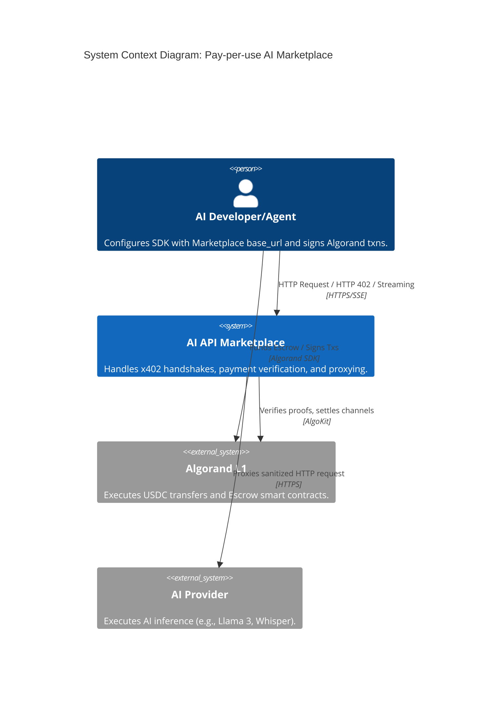
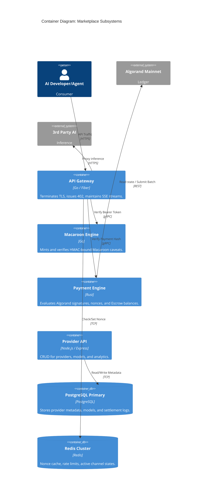
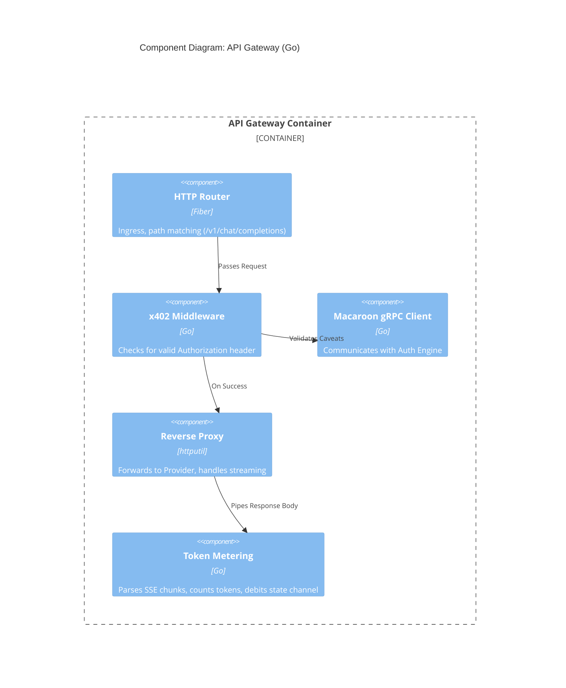
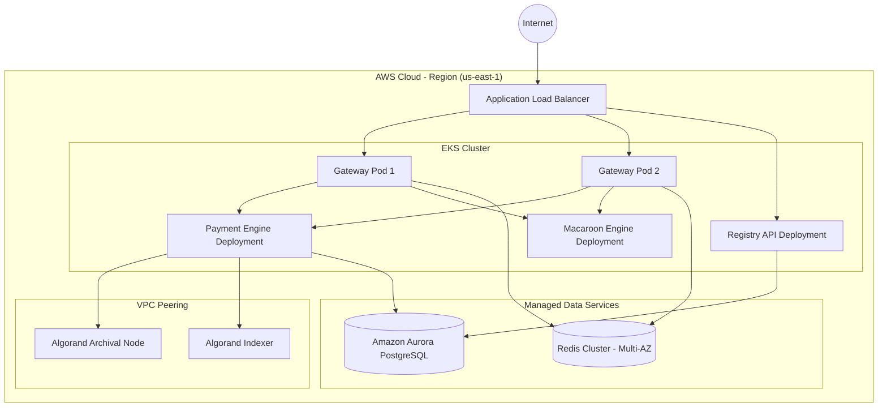
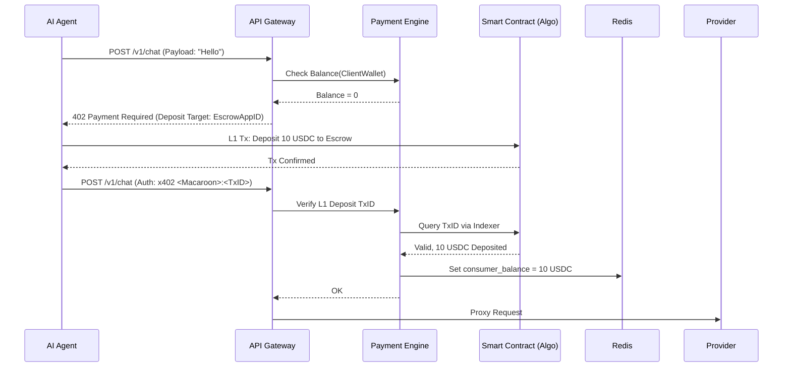
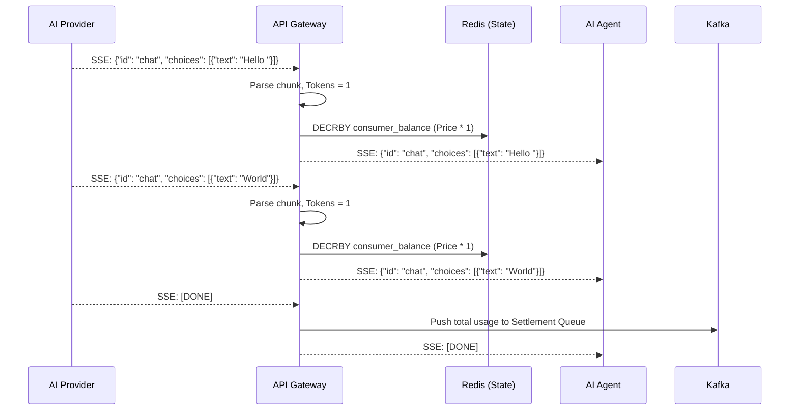

# Architecture.md

**Project:** Pay-per-use AI Marketplace (x402 + Algorand)
**Status:** Production Design / Approved
**Date:** August 6, 2026
**Authors:** Interdisciplinary Engineering Council

---

## 1. System Overview

### 1.1 Goals

* **Frictionless M2M Commerce:** Enable autonomous AI agents to consume third-party AI APIs (LLMs, OCR, Data processing) using HTTP 402 without prior account creation.
* **Instant Settlement:** Utilize Algorand's 2.8s finality and sub-cent fees to execute micro-transactions natively in USDC.
* **Zero Trust Proxying:** The API Gateway must trust neither the Consumer (double-spend risk) nor the Provider (fraudulent token counts).
* **OpenAI API Compatibility:** The external interface must perfectly mirror the OpenAI `/v1/chat/completions` spec so existing agent SDKs require only a `base_url` change.

### 1.2 Non-Goals

* Running or hosting our own foundational AI models. We are the payment routing layer.
* Supporting fiat credit cards directly in the critical path (fiat on-ramps exist out-of-band to fund wallets).
* Full Layer 1 settlement per HTTP request for streaming LLMs (latency makes this unviable; we use state channels).

### 1.3 Functional Requirements

* **Gateway:** Intercept requests, issue HTTP 402 challenges with Macaroons, and verify Algorand transactions.
* **Payment Engine:** Manage on-chain Escrow deposits, verify off-chain micro-transaction signatures, and execute batch settlements.
* **Provider Registry:** Allow third-party AI providers to register webhooks, set prices (per 1k tokens), and view usage analytics.
* **Streaming Support:** Parse Server-Sent Events (SSE) from providers to count tokens on the fly and bill the state channel accordingly.

### 1.4 Non-Functional Requirements (NFRs)

* **Latency:** Gateway overhead (excluding LLM inference and L1 settlement) must be < 50ms.
* **High Availability:** 99.99% uptime for the Gateway. Stateless architecture.
* **Scalability:** Must support 10,000 concurrent streaming connections per Gateway instance.
* **Idempotency:** Strict enforcement of nonce/transaction deduplication to prevent replay attacks.

### 1.5 Assumptions

* AI Agents have access to Algorand Wallets (via CDP, viem, or AlgoKit) to sign transactions programmably.
* Algorand RPC nodes will not throttle our indexer reads (mitigated by hosting our own Archival nodes).

---

## 2. C4 Architecture

### 2.1 Context Diagram

The Context diagram shows how external actors interact with the system.

### 2.2 Container Diagram

Breaking down the `System(marketplace)` into runnable containers.

### 2.3 Component Diagram: API Gateway

Diving into the internal architecture of the Go API Gateway.

### 2.4 Deployment Diagram

AWS/GCP production topology for high availability.

---

## 3. Microservices Architecture

### 3.1 API Gateway Service

* **Purpose:** The zero-trust reverse proxy and streaming terminator.
* **Responsibilities:** HTTP 402 challenge generation, SSE stream forwarding, real-time token counting.
* **Dependencies:** Redis (rate limits), Macaroon Engine (auth), Payment Engine (verification), AI Providers.
* **Failure Modes:** OOM crashes from too many open SSE connections.
* **Scaling:** CPU/Memory bound. Autoscales horizontally based on active TCP connections.
* **Monitoring:** `active_connections`, `proxy_latency_ms`, `402_challenge_rate`.

### 3.2 Payment Engine Service

* **Purpose:** The bridge between HTTP requests and the Algorand blockchain.
* **Responsibilities:** Validating off-chain ED25519 signatures, tracking state channel balances in Redis, batching L1 settlements.
* **Internal Flow:** Receives a TxID or Signature -> Checks Redis for replay -> Queries Algorand Node -> Commits state -> Returns boolean to Gateway.
* **Failure Modes:** Algorand RPC node goes down resulting in verification stalls.
* **Scaling:** Computationally lightweight, scales linearly.

### 3.3 Macaroon Engine Service

* **Purpose:** Cryptographic token management.
* **Responsibilities:** Minting tokens bound to `request_hash`, `provider_id`, `max_cost`.
* **Data Ownership:** Owns the root HMAC secret keys.

### 3.4 Provider Registry & Marketplace API

* **Purpose:** The control plane for the web dashboard.
* **Responsibilities:** Provider onboarding, model pricing configuration, API key generation for the UI.
* **Data Ownership:** PostgreSQL (Users, Providers, Models, Historical Usage).

---

## 4. Database Design

### 4.1 PostgreSQL (Primary Database)

We use a relational model because billing, provider payouts, and analytics require ACID properties. No PII is stored for AI Agents, only wallet addresses.

* **`providers`**: `id`, `wallet_address` (unique), `webhook_url`, `status`, `reputation_score`, `created_at`.
* **`models`**: `id`, `provider_id` (FK), `name` (e.g., "llama-3-70b"), `type` (LLM, Vision, OCR), `price_per_1k_usdc`, `is_active`.
* **`escrow_accounts`**: `id`, `wallet_address` (unique), `on_chain_balance`, `locked_balance`, `updated_at`.
* **`settlement_logs`**: `id`, `consumer_wallet`, `provider_id`, `model_id`, `tokens_used`, `usdc_amount`, `algo_tx_id` (Nullable until settled), `timestamp`. (Append-only ledger).

*Read-Heavy Paths:* Model Discovery (`SELECT * FROM models WHERE is_active=true`).
*Write-Heavy Paths:* The Gateway does **not** write to Postgres synchronously. `settlement_logs` are written via background Kafka/Redis queues post-inference.

### 4.2 Redis (In-Memory State)

* **What belongs in Redis:**
1. **Nonces:** `SET nonce:<hash> 1 EX 60 NX`. Used to strictly prevent replay of the same signed Macaroon.
2. **State Channel Balances:** `consumer:<wallet>:remaining_balance` (decremented in real-time as tokens stream).
3. **Rate Limits:** `rate_limit:<ip>` and `rate_limit:<wallet>`.

### 4.3 On-Chain (Algorand State)

* **What belongs on-chain:** Final, netted balances. Smart Contract holds the USDC. Escrow deposits, withdrawals, and batch settlements from the Payment Engine.
* **What NEVER belongs on-chain:** API payloads, prompts, AI responses, or individual per-token micro-payments.

---

## 5. Every Request Flow

### 5.1 Escrow Deposit & First Request

### 5.2 Streaming Response & State Channel Billing

### 5.3 Gateway Failure / Provider Offline

If the Provider returns a `502 Bad Gateway` or times out *after* the Macaroon is verified but *before* tokens are streamed, the Gateway immediately aborts, does NOT decrement the Redis balance, and returns a `503 Service Unavailable` to the Client. The Client's Escrow balance remains untouched.

---

## 6. Complete Payment Engine

The Payment Engine implements a **Unidirectional Payment Channel** architecture disguised behind HTTP 402. L1 transactions per request are unscalable; therefore, we decouple the challenge from the settlement.

1. **Verify (The 402 Handshake):** The client provides a Macaroon and a cryptographic signature over the request payload. The Payment Engine verifies the ED25519 signature against the Agent's public key.
2. **Streaming Billing (Off-Chain):** As the Gateway proxies SSE chunks, a goroutine asynchronously decrements the user's allocated session balance in Redis. If the balance hits zero, the Gateway forcefully truncates the TCP connection to the Provider and sends an HTTP 402 error chunk to the client.
3. **Settle (On-Chain):** Every 1 hour (or when a Provider requests withdrawal), the Payment Engine aggregates all `settlement_logs`. It creates an Algorand **Atomic Transfer** (Group Transaction):
* Tx 1: Contract calls Provider A (Payout)
* Tx 2: Contract calls Marketplace (1% Fee extraction)
* The Gateway signs this batch using its Operator Key.

4. **Refunds:** Because billing is done post-inference based on actual token output, "refunds" are irrelevant. You are only billed for what was successfully streamed through the Gateway.
5. **Smart Contract (Escrow):** A Teal v8 smart contract.
* `deposit(usdc_amount)`
* `withdraw(amount)` (Subject to Gateway releasing the lock).
* `settle_batch(merkle_root, allocations)` (Only callable by the Gateway Operator).

---

## 7. AI Gateway Pipeline

The core logic of the Go Gateway processing a single `/v1/chat/completions` request.

1. **Ingress:** Fiber accepts the TCP connection.
2. **Auth (No Header):** If `Authorization` is missing, immediately generate an HTTP 402. Call Macaroon Engine to mint a token with caveats: `method=POST`, `path=/v1/chat`, `expires=+60s`.
3. **Verification (With Header):** Extract Macaroon and Signature. Validate HMAC. Validate Nonce in Redis (prevent replay). Verify Escrow balance > estimated max cost.
4. **Routing:** Read `model` from JSON body. Query Registry (cached in Redis) to find the webhook URL of the cheapest/fastest Provider hosting that model.
5. **Streaming Proxy:** Open an `httputil.ReverseProxy` to the Provider.
6. **Usage Metering:** Attach an `io.Writer` interceptor to the response stream. Use a regex/tokenizer to count `\n\ndata: ` chunks natively.
7. **Logging:** Upon `[DONE]`, push a struct `{consumer, provider, tokens, price}` to a message queue for asynchronous database insertion.

---

## 8. Provider Architecture

**How Providers Join:**
A provider (e.g., an independent data center running vLLM) connects their wallet to our web dashboard. They deploy their model and expose it via HTTPS. They register their endpoint URL and price (e.g., `0.10 USDC / 1M tokens`) in our Registry.

**Trusting the Provider:**
We don't. We act as a man-in-the-middle. If a provider's hardware injects garbage to inflate token counts, the Consumer will flag it, and our Abuse Detection systems will throttle the Provider's reputation score.

**Health Checks:**
A background worker pings `/v1/models` on all registered Provider webhooks every 30 seconds. If a provider fails 3 consecutive pings, `is_active` is set to `false`, and the AI Router removes them from the load balancing pool.

---

## 9. Consumer Architecture

Developers interact with the marketplace exactly as they would with OpenAI, with a single wrapper to handle the 402 intercept.

**Python SDK Compatibility Layer (Example concept, no code):**
A developer imports standard `openai` library. They wrap the HTTP transport using an `x402-client` middleware.
When the `openai.ChatCompletion.create()` fires, the middleware intercepts the 402, automatically signs a payload using a local Algorand private key, and retries the request seamlessly. To the parent Python application, it just looks like a standard API call that took an extra 50ms.

---

## 10. Marketplace Design

The Web UI (Next.js) acts as the block-explorer and discovery engine for AI APIs.

* **Search & Discovery:** Indexed via PostgreSQL pg_trgm. Developers search for "Llama 3 70B Vision".
* **Ranking:** Results are ranked algorithmically based on `(1 / Price) * Uptime_Percentage * Latency_Score`.
* **Revenue Dashboard:** Providers see real-time streaming earnings graphs (queried from `settlement_logs`). Consumers see their Escrow burn rate.

---

## 11. Security Model

* **Trust Boundaries:** The Gateway is the absolute perimeter. No direct communication ever occurs between the Agent and the Provider.
* **Secret Management:** Gateway HMAC keys for Macaroons are rotated daily via AWS KMS. Algorand Operator Private Keys (used for batch settlements) reside in secure Enclaves (AWS Nitro) or HashiCorp Vault.
* **Wallet Security (Consumers):** Consumers only deposit what they wish to risk into the Escrow. The Marketplace cannot drain their main wallet.
* **DDoS & Replay:** Every signed request includes a Nonce. The Gateway attempts a `SETNX` in Redis. If it returns false, the request is dropped at Layer 7 before any crypto validation occurs. Rate limiting by IP and Wallet Address (e.g., max 100 req/sec) using Redis Sliding Windows.
* **Abuse Detection:** Providers manipulating SSE chunks to output invisible characters (to boost token counts) are detected by Gateway heuristics.

---

## 12. Observability & SRE

* **Metrics (Prometheus):**
* `gateway_requests_total{status, model, provider}`
* `gateway_402_challenges_total`
* `gateway_proxy_latency_seconds`
* `algorand_settlement_batch_size`

* **Tracing (OpenTelemetry):** Distributed tracing enabled on all Gateway requests, passing trace IDs to the Macaroon and Payment engines to debug slow verifications.
* **Logging (ELK Stack):** All dropped requests, invalid signatures, and failed health checks are logged. **Strict Rule:** HTTP request bodies (AI Prompts) are explicitly omitted from all logs to ensure data privacy.
* **SLOs:** Gateway verification latency < 50ms (99th percentile). Smart Contract batch settlement success rate > 99.9%.

---

## 13. DevOps & CI/CD

* **Environments:**
* `Dev`: Local Docker Compose (Gateway, Postgres, Redis, Algorand Sandbox).
* `Staging`: AWS EKS interacting with Algorand Testnet.
* `Prod`: AWS EKS multi-region interacting with Algorand Mainnet.

* **Deployment Strategy:** Blue/Green deployments for the API Gateway. Because the Gateway is stateless and HTTP clients auto-retry, traffic can be instantly shifted at the Load Balancer level without dropping Escrow states (which live in Redis).

---

## 14. Architecture Decision Records (ADRs)

**ADR 1: Decoupling Settlement via State Channels**

* **Context:** Original spec called for per-request L1 settlements.
* **Decision:** Implement an Escrow smart contract and off-chain Redis balance tracking.
* **Tradeoffs:** Increases backend complexity and requires the Marketplace to act as a trusted arbiter of token counts. However, it is the *only* physical way to achieve <100ms latency and support streaming LLM billing.

**ADR 2: Using Go for the API Gateway**

* **Context:** Need a high-performance reverse proxy for SSE.
* **Decision:** Write the Gateway in Go using standard library `httputil.ReverseProxy`.
* **Tradeoffs:** Rust would offer slightly lower memory footprint, but Go's ecosystem for proxying, gRPC, and its native goroutine model for handling thousands of idle long-polling SSE connections makes it vastly superior for time-to-market and maintainability.

**ADR 3: Algorand native USDC for Payments**

* **Context:** Agents need a stable unit of account.
* **Decision:** Mandate Algorand standard asset USDC (ASA ID 31566704).
* **Tradeoffs:** Excludes agents holding ETH or SOL. Mitigated by future cross-chain swap integrations (e.g., using Wormhole to bridge funds into the Escrow).

---

## 15. Risk Register

* **Technical Risk:** Algorand RPC nodes rate-limiting the Payment Engine during peak load. *Mitigation:* Self-host Algorand Archival nodes in the VPC.
* **Business Risk:** Major model providers (OpenAI) block our IP ranges to prevent reselling. *Mitigation:* The marketplace targets open-source models hosted by independent decentralized compute providers (Akash, Render), not wrapping Web2 APIs.
* **Security Risk:** Redis cluster goes down, losing active State Channel balances. *Mitigation:* Redis AOF (Append Only File) persistence and aggressive asynchronous checkpoints to PostgreSQL.

---

## 16. Future Evolution

* **Phase 1 (Hackathon/MVP):** Hardcoded Provider, direct Algorand Testnet Atomic Transfers (no state channels), single Go binary.
* **Phase 2 (Beta):** State Channels implemented. Redis token tracking. Real providers onboarding via the Next.js UI.
* **Phase 3 (Production):** Distributed Gateways, Algorand Mainnet USDC, Provider health checks, auto-routing based on latency.
* **Phase 4 (Protocol / Agent Economy):** The Gateway software is open-sourced. Anyone can run a "Facilitator Node". The marketplace transitions from a centralized SaaS to a decentralized routing network where Gateway operators earn a 0.1% spread for facilitating x402 traffic.

---

## 17. Final Engineering Review (CTO Critique)

**Self-Critique & Corrections during design:**

* *Flaw Identified:* Originally, I considered parsing the JSON response entirely before billing.
* *Correction:* LLMs stream. Waiting for the full JSON response breaks the UX. I mandated the `io.Writer` interceptor to parse SSE chunks on the fly to decrement balances dynamically.

* *Flaw Identified:* If a client drops their TCP connection mid-stream to avoid paying for the final tokens.
* *Correction:* The Gateway acts as the arbiter. The Gateway has already downloaded the chunk from the Provider. The Gateway will bill the client's state channel for what the Provider sent, regardless of whether the client closed their socket early.

* *Flaw Identified:* How do we handle API endpoints that are NOT streaming (e.g., Vision/OCR image processing)?
* *Correction:* The x402 challenge must include a `max_cost` caveat for non-streaming APIs. The Gateway locks the `max_cost` from Escrow upfront, proxies the request, and refunds the unspent difference immediately after the response finishes.

**Conclusion:**
The architecture transitions the initial naive concept of "L1 transactions per API call" into a production-grade, state-channel-backed reverse proxy. It ensures sub-100ms latency, eliminates blockchain bloat, and provides a zero-friction OpenAI-compatible interface for autonomous AI agents. The design is approved for Phase 1 implementation.