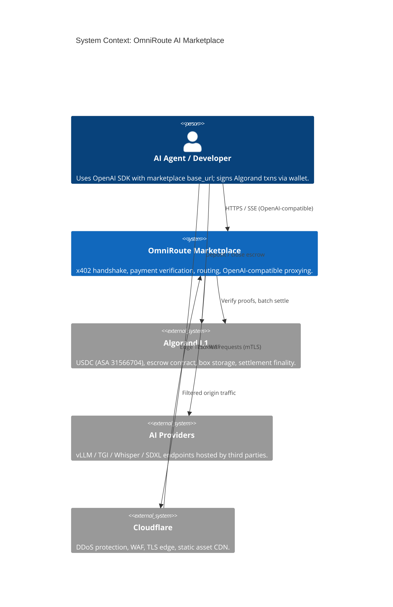
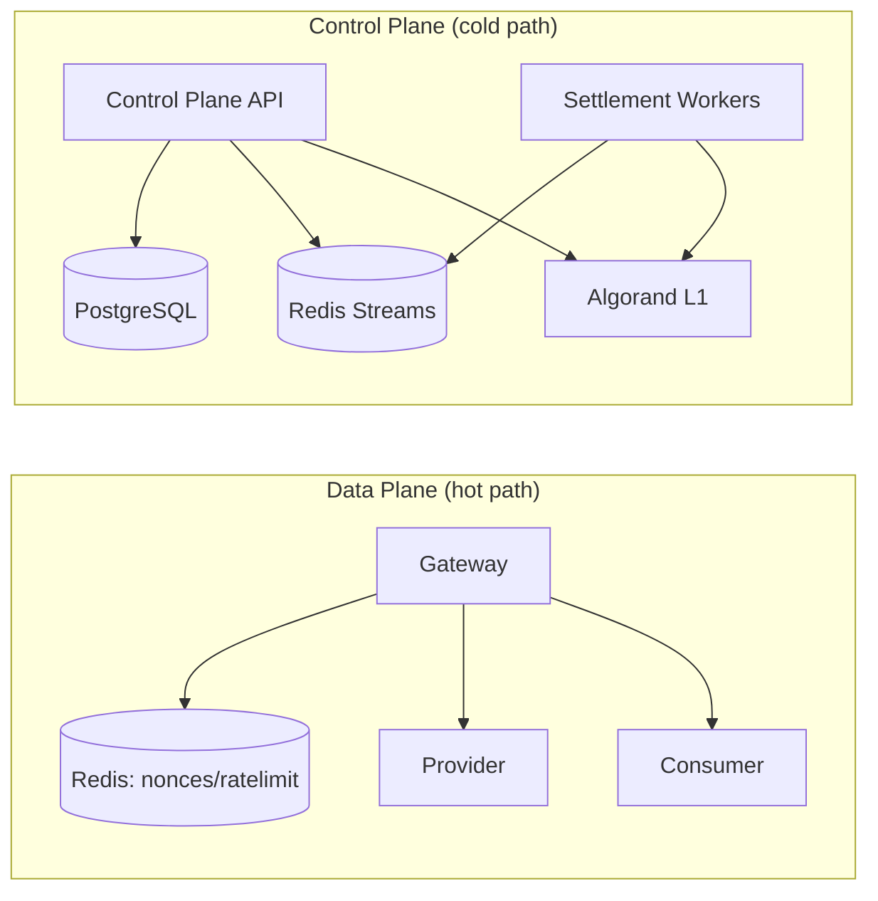
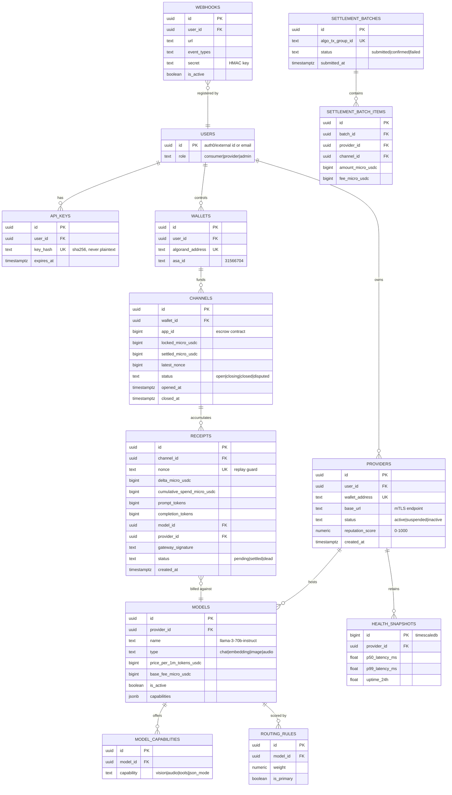
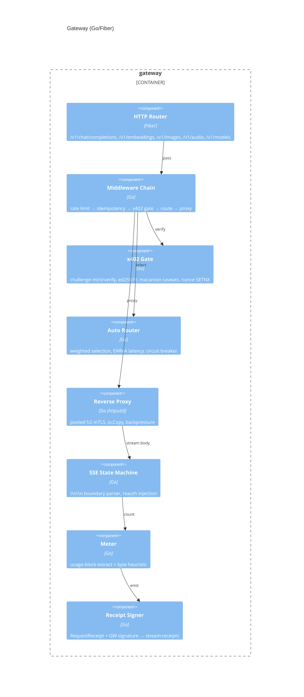
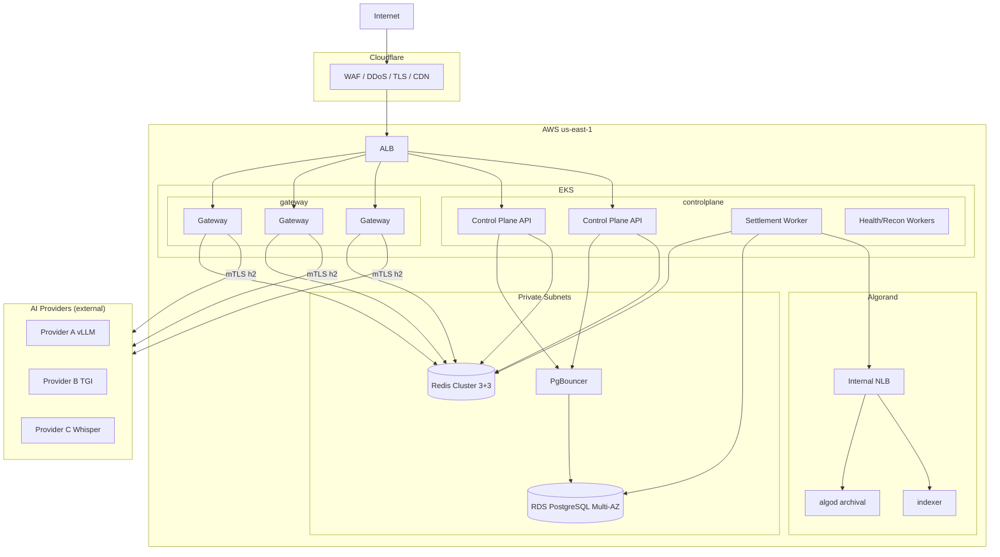
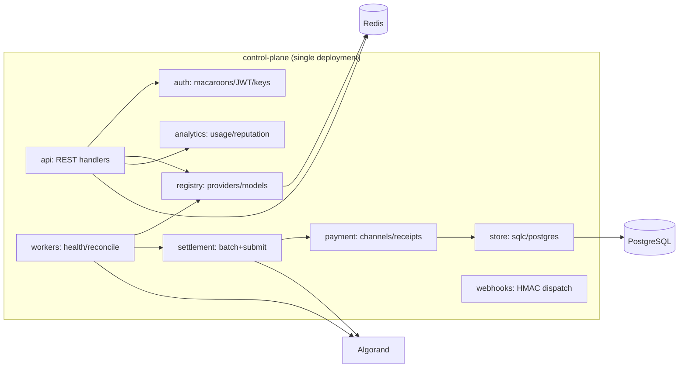

# OmniRoute AI Marketplace — Engineering Design Document

**Version:** 1.0.0
**Status:** Approved for Implementation Review
**Date:** August 6, 2026
**Author:** Lead Architect (on behalf of 4-engineer team)

---

## 0. Executive Summary & Guiding Principles

### 0.1 What We Are Building

A decentralized, pay-per-use AI marketplace where AI agents and developers consume OpenAI-compatible APIs (`/v1/chat/completions`, `/v1/embeddings`, `/v1/images`, `/v1/audio`) backed by HTTP x402 payments and settled on the Algorand blockchain in native USDC. Developers change only their `base_url`; everything else is wire-compatible with OpenAI. The marketplace mediates a hostile, zero-trust relationship between consumers (who want free compute) and providers (who want to over-charge).

### 0.2 Architecture Principles

1. **Fail-Closed Financial Path.** Never process a paid request without replay protection, signature verification, and escrow validation. `503` beats `402`-bypassed.
2. **Data Plane / Control Plane Separation.** The high-throughput proxy path (Gateway) never does synchronous database I/O, synchronous blockchain I/O, or heavy computation. All persistence and settlement is asynchronous.
3. **Cryptographic State, Not Database State.** The authoritative financial balance of a payment channel is the *latest consumer-signed cumulative receipt* — not a Redis counter. Redis is a cache and anti-replay guard, never the source of financial truth.
4. **OpenAI Wire Compatibility Is a Hard Requirement.** Any deviation from the OpenAI response/streaming schema is a release blocker.
5. **Modular Monolith Over Microservices (for a 4-engineer team).** Premature microservice decomposition creates operational overhead that a team of 4 cannot sustain. We use *two* deployable units: the **Gateway** (data plane, scales independently) and the **Control Plane API** (modular monolith). See ADR-05.
6. **Observability as a First-Class Feature.** Every request carries a trace ID. Every financial event is structured-logged. Prometheus metrics are shipped from day 1.

### 0.3 Non-Functional Requirements (NFRs)

| NFR | Target |
|---|---|
| Gateway overhead (P99, excl. LLM inference) | < 25 ms |
| Ed25519 proof verification (P99) | < 3 ms |
| End-to-end TTFT (P90) | < 500 ms |
| Concurrent streaming connections / Gateway node | 10,000 |
| Availability (Gateway) | 99.99% |
| Algorand settlement batch success | > 99.9% |
| Global request timeout (non-streaming) | 120 s |
| Gateway → Provider connect/TLS timeout | < 500 ms |
| Financial RPO | 0 (state reconstructible from Algorand L1) |
| Financial RTO | < 5 min (batch settlement replay) |

### 0.4 Critical Review of Prior Documents

The workspace already contains strong prior design work (`Architecture.md`, `PaymentEngine.md`, `API_Specification.md`, `System_Design.md`, `Research*.md`). This document validates, corrects, and extends that work. The most important corrections are:

1. **Redis failure is not "catastrophic" (contradicting System_Design §10).** Because financial state lives in client-signed receipts, a Redis outage degrades anti-replay protection and forces fail-closed 503s — but no money is lost. The system must *fail closed* during outage, then recover by rehydrating nonces from the settlement log. We reframe this in §7, §22.
2. **Microservice topology is over-decomposed** for 4 engineers. We collapse Registry, Macaroon Engine, Settlement Engine, and Provider API into one Control Plane deployment (§3).
3. **The unidirectional payment channel was not fully specified.** We now define the exact receipt structure, cumulative-spend model, and on-chain settlement proof (§10, §22).
4. **Dispute handling was missing.** The API spec mentions a 24h dispute window; the Payment Engine never implemented it. We add a provider payout hold period (§10).
5. **Settlement batching cost model was incomplete.** We specify the minimum-settlement threshold and dust policy explicitly (§10).
6. **The queue choice (Redis Streams only) is a production risk.** We recommend Redis Streams for MVP but design a transport abstraction to migrate to NATS JetStream for multi-region durability (§7, ADR-03).

---

## 1. High Level Architecture

### 1.1 Purpose

Define the top-level system boundaries, actors, and data flows before any implementation work begins.

### 1.2 System Context



**Key invariant:** The AI Agent *never* communicates directly with the Provider. The Gateway is the only egress path to providers, enforced by provider-side firewall allow-listing of Gateway NAT IPs.

### 1.3 Responsibilities, Data Ownership

| Component | Responsibilities | Owns |
|---|---|---|
| Cloudflare Edge | TLS 1.3 termination, WAF, DDoS mitigation, rate-limit pre-filter, CDN for dashboard assets | Ephemeral edge state only |
| Gateway (Go) | 402 challenges, proof verification, nonce dedup, routing, SSE proxy, token metering, receipts, rate limits | No persistent data; ephemeral connection state |
| Control Plane API (Go) | Provider/consumer onboarding, model registry, API keys, dashboards APIs, webhooks, settlement orchestration, reconciliation, reputation | PostgreSQL (system of record for non-financial & historical state) |
| Redis | Nonce dedup cache, rate-limit counters, idempotency keys, session coordination, ephemeral receipt queue | Ephemeral; reconstructible |
| PostgreSQL | Providers, models, API keys, usage analytics, settlement journal (append-only), webhook endpoints, consumer wallets | Historical/analytical records; **not** authoritative for channel balances |
| Algorand Escrow Contract | Lock USDC, accept signed cumulative receipts, pay providers + marketplace fees, refund consumers | **Authoritative** financial state |
| Algorand Node + Indexer | Read L1 state, verify deposits/closure events | Ledger data |

### 1.4 Tradeoffs

- **Centralized Gateway vs. decentralized P2P:** The Gateway keeps the system Web2-simple for providers (they host standard HTTP servers) while delivering Web3 payments. Tradeoff: the marketplace is a trusted metering arbiter. Mitigated by publishing all receipts on-chain and open-sourcing the Gateway for Phase 4 (protocol) evolution.

### 1.5 Future Improvements

- Open-sourced Gateway sidecar so large providers run x402 locally (Phase 4).
- MCP (Model Context Protocol) tool-payment bridging.

---

## 2. Low Level Architecture

### 2.1 Purpose

The granular execution layer: network paths, hot-path vs. cold-path communication, buffer management, and timeouts.

### 2.2 Data Plane vs. Control Plane



**Hard rules:**
- The Gateway does **zero synchronous PostgreSQL I/O** and **zero synchronous Algorand RPC** calls.
- The Gateway's only synchronous external dependency is Redis (SETNX nonce, token-bucket rate limit, channel-state cache read).
- All per-request financial records (`RequestReceipt`) are pushed to Redis Streams fire-and-forget; the Settlement Worker persists them to PostgreSQL *and* batches them to L1.

### 2.3 Request Lifecycle (Low Level)

1. **Ingress:** Cloudflare → ALB → Gateway. TLS terminated at Cloudflare; origin TLS between Cloudflare and Gateway (TLS 1.3).
2. **Pre-filter:** IP rate limit, WAF, body-size limit (e.g., 10 MB), idempotency-key check.
3. **x402 Gate:**
   - No proof header → compute `C_max` from model price + `max_tokens` → mint challenge (cost quote, nonce, escrow ID, expiry `+120s`) → `402` + `X-402-Payment-Required`.
   - Proof present → verify Ed25519 signature over `SHA-512/256(body ‖ nonce ‖ model ‖ timestamp)`; verify caveats (escrow ID, model, expiry); `SETNX` nonce in Redis (TTL = proof expiry); check cached channel balance ≥ `C_max`; lock `C_max` (pre-authorization) on the channel cache.
4. **Routing:** Read model key from JSON body (read once, buffered copy for hashing). Look up routing table in Gateway local cache (synced from Control Plane via gRPC watch / Redis pub-sub). Select provider by weighted scoring (§13).
5. **Proxy:** Open pooled HTTP/2 connection to provider with mTLS. Forward sanitized request (strips any provider-facing auth; adds `X-Request-ID` and `traceparent`). Bound connect/TLS to 500 ms.
6. **Streaming / Metering:** For `stream: true`, stream-parse SSE events via a custom `\n\n` boundary state machine. Count tokens using the provider `usage` block when present (final authoritative count) and a byte-heuristic fallback for abnormal termination. For non-streaming `stream: false`, buffer full response (bounded, e.g., 16 MB), extract `usage`, then release.
7. **Billing Decision:** Build `RequestReceipt` — signed by the Gateway's cold key — containing cumulative-channel delta. Push to Redis Streams. For pre-authorized (non-streaming) requests, release the unspent remainder on the channel cache.
8. **Client termination:** If client disconnects, send `RST` to provider immediately (stop inference cost). If provider disconnects abnormally, bill partial usage up to last valid chunk, return `502`/synthetic SSE error to client.

### 2.4 Buffer & Backpressure Management

- Use `sync.Pool` for `[]byte` buffers; target zero-allocation in steady state.
- Per-connection write buffer to client capped (e.g., 64 KB). If the client reads slowly and buffers fill for > 5 s, terminate connection (slowloris mitigation) and bill up to the last forwarded chunk.
- Goroutine-per-connection model; `GOMEMLIMIT` set; `GOGC=200`.
- FD tuning: `ulimit -n` = 1,000,000; each connection consumes ~2 FDs (client + provider).

### 2.5 Failure Modes

| Failure | Behavior | Recovery |
|---|---|---|
| Redis unreachable | Gateway fails closed → 503 for all paid paths | Redis multi-AZ; circuit retry; alerts |
| Provider connect fails | 503/504 to client; no charge (receipt not emitted) | Circuit breaker; provide failover provider |
| Provider mid-stream crash | Bill partial usage; synthetic error SSE; `502` | Client retry with new nonce |
| Gateway crash | Connection drops; no receipt → provider eats cost | Stateless; ALB reroutes; acceptable |
| Settlement worker down | Receipts accumulate in Streams | HPA/leader election; DLQ for poison receipts |

### 2.6 Scaling Strategy

- Gateway: HPA on CPU (70%) + active-connection gauge + P99 latency.
- Redis: cluster mode with hash tags `{channel:<id>}` to co-locate nonce + balance + rate limit for a channel.
- Control Plane: HPA on CPU and queue depth (Redis Streams `XLEN`).
- Settlement workers: single-leader (Redis lock) to avoid L1 account nonce collisions.

---

## 3. Microservice Architecture

### 3.1 Purpose & Critical Decision

Define deployable units. **Correction to prior docs:** the prior 5-service topology (Gateway, Payment Engine, Macaroon Engine, Registry, Settlement) is over-decomposed for 4 engineers. We adopt **two deployable units** with clear internal module boundaries:

```
Deployable Unit 1: gateway          (data plane, horizontally scaled)
Deployable Unit 2: control-plane    (modular monolith)
  ├─ api/           → REST/OpenAPI (marketplace, provider, consumer, admin)
  ├─ auth/          → macaroon minting, API key management, JWT for dashboards
  ├─ payment/       → channel lifecycle, receipt journal, settlement orchestration
  ├─ settlement/    → batch builder, L1 submitter, reconciliation, DLQ
  ├─ registry/      → providers, models, pricing, routing-table publisher
  ├─ webhooks/      → outbound webhook dispatcher with HMAC signing
  ├─ analytics/     → usage aggregation, reputation scoring
  └─ workers/       → background jobs (health checks, retention, reconciliation)
```

**Why a modular monolith?**
- 4 engineers cannot operate 5+ microservices (service mesh, deploy tooling, contract versioning, tracing across many hops) *and* build the product.
- The only component requiring independent scaling is the Gateway (10k connections/node, data plane).
- The Control Plane API has modest QPS (dashboards, registration, settlement) — one deployment with internal packages suffices.
- Module boundaries are enforced at the package level so a future split is a mechanical extraction, not a rewrite.

### 3.2 Module Responsibilities, Interfaces, Dependencies

| Module | Responsibilities | Interfaces (internal) | Depends On |
|---|---|---|---|
| `api` | REST controllers, OpenAPI-validated | HTTP handlers | auth, registry, analytics |
| `auth` | Mint/verify macaroons; issue JWT for dashboard sessions; manage API keys (hashed) | Go interface `MintMacaroon`, `VerifyMacaroon` | redis (nonce), postgres (api keys) |
| `payment` | Channel lifecycle events, receipt journal, escrow cache hydration | Go interface `RecordReceipt`, `ObserveChannel` | postgres, redis, algorand indexer |
| `settlement` | Aggregate receipts per channel → build L1 tx group → submit → verify | Go interface `SubmitBatch` | algorand node, postgres, redis |
| `registry` | CRUD providers/models/pricing; publish routing table | Go interface `ListRoutableModels` | postgres, redis |
| `webhooks` | Deliver events with HMAC-SHA256 signature, retry w/ backoff | HTTP outbound | postgres, redis (delivery queue) |
| `analytics` | Aggregate usage, compute reputation & latency EWMA | Go interface `GetProviderStats` | postgres |
| `workers` | Health pings, reconciliation, ledger retention | cron + queue consumers | all above |

### 3.3 Gateway ↔ Control Plane Contracts (gRPC)

- `RegistryService.WatchRoutingTable()` — server-streaming push of model/provider/pricing updates.
- `PaymentService.HydrateChannel(channelId)` — pull L1-verified channel state into Redis cache.
- `AuthService.MintChallenge(req)` — generate 402 challenge (may also be local Ed25519; see §9).
- Protobufs live in `proto/` and are shared as a Go module.

### 3.4 Failure Modes

- Control-plane outage does **not** stop the data plane: Gateways serve from local routing-table cache (stale ≤ 60 s) and already-hydrated channel cache. New escrow deposits will not be recognized until control plane recovers (bounded by staleness).

### 3.5 Tradeoffs & Future

- *Tradeoff:* Modular monolith couples compute; future split is mechanical because boundaries are package-level.
- *Future:* When settlement load exceeds one deployment, extract `settlement/` as a standalone worker fleet (already container-ready).

---

## 4. Folder Structure (Application Level)

```
/internal
  /gateway
    /cmd/gateway            # entrypoint
    /pkg
      /server               # Fiber/http server bootstrap, middleware chain
      /x402                 # challenge minting, proof verification
      /crypto               # ed25519 verify, macaroon libs
      /nonce                # redis SETNX wrapper
      /ratelimit           # token bucket (redis)
      /router              # routing table, provider selection, circuit breaker
      /proxy               # reverse proxy, SSE pump, stream parser
      /meter               # token counting (usage-block ext + byte heuristic)
      /receipt             # RequestReceipt builder + signer
      /channel             # channel balance cache (redis hash)
      /grpcclient          # control-plane clients
  /controlplane
    /cmd/controlplane      # API server entrypoint
    /cmd/workers           # background workers entrypoint
    /internal
      /api                 # REST handlers + OpenAPI
      /auth                # macaroons, JWT, api keys
      /payment             # channel & receipt domain
      /settlement          # batch builder + L1 submitter
      /registry            # providers/models/pricing
      /webhooks            # dispatcher
      /analytics           # reputation, usage aggregation
      /workers             # health checks, reconciliation
      /store               # postgres repositories (sqlc)
      /algorand            # indexer/node client, tx-builder
  /contracts               # Teal v8 source (AlgoKit), tests, deploy scripts
  /proto                   # shared protobuf defs
  /sdk                     # x402 client SDKs (python, ts)
  /openapi                 # OpenAI-compatible + extended schemas
  /infra                   # terraform, k8s manifests, docker
  /scripts
  /test                    # e2e, load, integration harness
```

---

## 5. Repository Structure (Monorepo)

One monorepo (`omniroute`) to maximize parallel development and atomic cross-cutting changes (schema + gateway + SDK conformance).

```
omniroute/
├── .github/workflows/          # CI/CD pipelines
├── apps/
│   ├── gateway/                # Go module: data plane
│   ├── controlplane/           # Go module: API + workers
│   └── web/                    # Next.js 15 dashboard/marketplace
├── packages/
│   ├── sdk-python/             # x402 client (openai SDK compatible)
│   ├── sdk-typescript/         # x402 client
│   ├── contracts/              # TEAL source + algokit project
│   ├── proto-ts/               # generated protobuf (web)
│   └── config/                 # shared env schemas
├── infra/                      # terraform, k8s, docker-compose, helm
├── proto/                      # .proto sources
├── openapi/                    # OpenAPI 3.1 + spectral rules
├── docs/                       # this document + ADRs + runbooks
└── Makefile / Taskfile.yml
```

**Parallel dev strategy:** `apps/gateway`, `apps/controlplane`, `apps/web`, `packages/contracts` are independently buildable. Contract-first definitions (`proto/`, `openapi/`, TEAL) are the integration points.

---

## 6. Database Design (PostgreSQL)

### 6.1 Purpose

Persist all non-authoritative state: provider registrations, models/pricing, API keys, consumer wallets, the append-only settlement journal, webhook registrations, and usage analytics. **The database is never the source of financial truth** — it is a queryable journal that can be rebuilt from L1.

### 6.2 Schema (with ER relationships)



### 6.3 Storage & Indexing

- **Partitioning:** `receipts` partitioned monthly (range on `created_at`) — write-heavy journal. `health_snapshots` uses TimescaleDB or a `chunked` table (retention 7 days, downsampled to 1 hour beyond).
- **Indexes:** `receipts(nonce)` unique; `receipts(channel_id, created_at DESC)`; `models(name, is_active)`; `providers(status)`.
- **Full-text search:** `pg_trgm` GIN index on `models.name` and `models.capabilities` for marketplace search.
- **No PII in AI payloads:** prompts/responses are never stored. Byte/token counts only.

### 6.4 PostgreSQL vs. CockroachDB (Tradeoff)

| Criterion | PostgreSQL | CockroachDB |
|---|---|---|
| Ops burden (4-engineer team) | Low (RDS/Aurora managed) | Higher (multi-node distributed ops) |
| Consistency | Strong (single-writer) | Serializable (distributed) |
| Scale ceiling | Vertical + read replicas (~100k QPS reads) | Horizontal writes |
| Our write volume | Moderate (async journal; Gateway never writes sync) | Unnecessary |
| Verdict | **Selected** — our write path is already async and batched; read scaling via replicas suffices. | Defer until multi-region active-active writes are required. |

### 6.5 Failure Modes & Scaling

- *Failure:* Primary DB down → Gateway unaffected (no sync DB in hot path); dashboards/settlement pause. Replica promotion or RDS Multi-AZ failover.
- *Scaling:* read replicas for analytics; connection pooler (PgBouncer) for control plane; partition receipts before size exceeds 1 TB.

---

## 7. Redis Design & Caching Strategy

### 7.1 Purpose

Redis serves five distinct, non-overlapping concerns. **Reframed:** Redis is *not* the source of truth for balances — see the "Cryptographic State" principle (0.2.3).

### 7.2 Key Namespaces

| Key Pattern | Type | TTL | Purpose | Reconstructible From |
|---|---|---|---|---|
| `nonce:{sha256(proof)}` | String `SETNX` | 300 s (proof expiry) | Replay prevention | Postgres `receipts.nonce` (on restart, rehydrate recent nonces) |
| `rl:ip:{ip}` | Token bucket (hash) | 60 s window | IP rate limit | — (transient) |
| `rl:wallet:{addr}` | Token bucket | 60 s window | Wallet/credit velocity | — (transient) |
| `rs:{model}:{region}` | Sorted set (provider score) | 60 s | Routing table cache | Postgres `models`/`routing_rules` |
| `ch:{channel_id}` | Hash (`locked`, `spent`, `cached_verified_at`) | 15 min, refreshed | Channel balance *cache* (hydrated from L1 proof) | Algorand L1 + latest signed receipt |
| `idem:{key}` | String | 24 h | Idempotency-Key response cache | — (transient by design) |
| `stream:receipts` | Stream | — | Settlement queue | Redis AOF + Postgres journal |
| `dlq:settlement` | Stream | — | Failed receipts | manual review |
| `webhook:queue` | Stream | — | Outbound webhook deliveries | Postgres |

### 7.3 Consistency & Durability

- Redis Cluster (3 masters + 3 replicas) with AOF `everysec`. Multi-AZ.
- `WAIT`/`WAITAOF` not needed on the hot path: a lost `SETNX` only allows a *replay* of an *already-paid* proof, and the proof signature plus Postgres nonce journal still block double-billing at settlement time. This layered defense means Redis is performance-optimized, not correctness-critical.
- **Fail-closed policy:** if Redis is unreachable, Gateway returns 503 for paid endpoints. It must never skip nonce checks.

### 7.4 Caching Strategy

| Cache | Key | Populated By | Invalidation | Staleness Bound |
|---|---|---|---|---|
| Routing table | `rs:{model}:{region}` | Control plane push (gRPC watch) | Provider health events | ≤ 60 s |
| Channel balance | `ch:{channel_id}` | Payment module hydrate on deposit/use | Receipts, L1 closure events | ≤ 15 min; but Gateway *locks* locally per request |
| Model pricing | `price:{model}` (part of routing) | Registry publish | Price change | ≤ 60 s |
| Provider reputation score | `rep:{provider}` | Analytics worker (1-min cadence) | — | ≤ 60 s |
| Nonces | `nonce:{hash}` | Gateway | TTL | 5 min |
| API key → user | `ak:{sha(key)}` | Auth module | Key revocation | ≤ 5 min |

**Local (in-process) caching:** Gateway keeps an in-memory mirror of the routing table + channel locks for the duration of an active stream (with `sync.RWMutex`). No `SETNX` per SSE chunk — the balance is locked once at request start.

### 7.5 Redis vs. NATS (Tradeoff)

| Criterion | Redis Streams | NATS JetStream | Kafka |
|---|---|---|---|
| Ops complexity | Low (already in stack) | Medium (small) | High (ZooKeeper/KRaft, brokers) |
| Durability | AOF (fsync everysec) | JetStream (Raft) | Strong (ISR replication) |
| Throughput | ~100k msg/s (single) | ~1M msg/s | Multi-MB/s sustained |
| Multi-region | Manual | Leaf nodes / gateways | MirrorMaker |
| Consumer groups | Yes (XREADGROUP) | Yes | Yes |
| 4-engineer fit | **MVP: Selected** | Best production upgrade path | Overkill here |

**Decision:** Redis Streams for the settlement queue in MVP (one less technology). The queue consumer (`settlement`) is implemented against a `Queue` interface so migrating to NATS JetStream (recommended at multi-region scale) is a ~1-week change. Use **NATS JetStream, not Kafka**, when we outgrow Redis: Kafka's operational burden is not justifiable for a 4-engineer team at our expected throughput.

---

## 8. Caching Strategy (Cross-Cutting)

- **L1 reads:** Never query Algorand indexer on the hot path. Control plane hydrates channel state into Redis; Gateway reads cache. Indexer queries are cached for 5 s.
- **OpenAI SDK compatibility checks:** A conformance test suite caches golden OpenAI responses for regression testing.
- **Dashboard analytics:** Materialized views refreshed every minute; never query raw `receipts` tables for dashboards.
- **Static assets (web):** Cloudflare CDN with `public, max-age=31536000, immutable` hashed assets.
- **Negative caching:** model-not-found (1 s), provider-unhealthy (5 s).

---

## 9. Authentication Architecture

### 9.1 Purpose

Separate *identity* (dashboards, API keys) from *payment authorization* (x402 proofs). Agents consume compute via proofs; humans administer via JWT sessions/API keys.

### 9.2 Layered Auth

| Layer | Mechanism | Used By | Notes |
|---|---|---|---|
| 1. Dashboard sessions | JWT (short-lived, 15 min) + refresh (7 d) | Consumers/Providers via web | Issued by Control Plane after wallet-signature login or OAuth (GitHub/Google) |
| 2. Control-plane API keys | `sk-...` random 32-byte; store SHA-256 hash | Programmatic onboarding, analytics | Standard bearer; scoped to user; revocable; rotation via REST |
| 3. x402 payment proofs | Ed25519 signature over challenge (below) | AI agents hitting inference endpoints | The "auth" for compute |
| 4. Macaroons (root) | HMAC-bound bearer token with caveats | Minted at channel creation/402 challenge | See ADR-04 |

### 9.3 The x402 Proof Construction (precise)

The proof is **not** a bare JWT and **not** a bare macaroon. It is a challenge-response signature, exactly modeled on strippeable HTTP message signatures:

```
proof := Ed25519_sign(
  consumer_sk,
  SHA-512/256(
    canonical_request   := method ‖ "\n" ‖ path ‖ "\n" ‖ sha256(body)
    ‖ "\n" ‖ nonce ‖ "\n" ‖ escrow_id ‖ "\n" ‖ max_cost_micro_usdc
    ‖ "\n" ‖ expires_at ‖ "\n" ‖ model
  )
)
```

- The Gateway mints the challenge (nonce, escrow id, `C_max`, expiry) — the consumer cannot invent challenges.
- The macaroon (when used) provides *caveat attenuation* on top: e.g., a channel root macaroon attenuated per-request with `max_cost` and `model` caveats. The Ed25519 signature provides *authentication*. Both are verified in < 3 ms (ed25519 is ~50 µs; the bottleneck is hashing the body, which is O(body size) — hence we bound body size at 10 MB and cache the body hash when the same payload is retried).
- Nonce/expiry bind the proof to one request. Idempotency-Key (optional) additionally dedupes retries.

### 9.4 JWT vs. Macaroons vs. Signed Challenge — Tradeoff

| Criterion | JWT (RS256) | Macaroon only | Ed25519 challenge-response (+ macaroon caveats) |
|---|---|---|---|
| Client attenuation | ✗ must contact issuer | ✓ third-party caveats | ✓ via macaroon layer |
| Verification cost | RSA/EC verify (~100 µs) | HMAC (~1 µs) + sig | sig (~50 µs) |
| Replay resistance | Needs `jti` store | Nonce caveat + store | Nonce + store |
| Ecosystem support | Excellent | Weak libs (Go `go-macaroon` is fine; TS/Python thinner) | Excellent (ed25519 everywhere) |
| Fits our threat (hostile agent) | Requires central server per attenuation | Best-in-class abstraction | **Selected** — raw speed + attenuation via macaroon complement |

**Verdict:** Prior docs were right to choose macaroons over JWT for *attenuation*; we additionally *mandate* the Ed25519 request signature because (a) it binds the proof to the exact body (non-repudiation), and (b) it uses the same key type as Algorand accounts, reducing SDK complexity (one keypair does deposits *and* request signing).

### 9.5 Key Management

- **Consumer keys:** in consumer wallets; marketplace never sees private keys.
- **Gateway receipt-signing key:** cold key in Vault/KMS, used to sign `RequestReceipt` for audit; hot key cached in process memory.
- **Settlement operator key (L1):** HSM-backed (AWS KMS) — never in container env.
- **Macaroon HMAC root secret:** rotated daily via KMS; dual-key (current/previous) support for rotation windows.

---

## 10. Payment Architecture

### 10.1 Purpose

Enable sub-10 ms authorization for streaming AI while guaranteeing that the marketplace cannot steal funds, consumers cannot get free compute, and providers cannot over-charge.

### 10.2 Unidirectional Payment Channel (State Channel) — Precise Model

The **only** authoritative financial state is the **latest consumer-signed cumulative receipt** per channel.

**Channel lifecycle:**

1. **Open:** Consumer calls `escrow_open(provider_allowlist, gateway_pubkey)` on the TEAL v8 contract, funding locked USDC in an atomic transfer group that also pays the box MBR in ALGO (refunded at close). Contract creates `Box(sha256(consumer ‖ gateway))` with `[locked, settled, latest_nonce]`.
2. **Use:** For each request, consumer sends proof (challenge sig). Gateway verifies, streams, then emits `RequestReceipt{channel_id, nonce, delta, cumulative_spend, tokens, model, provider, gw_sig}`. The consumer's *authorization* for `cumulative_spend` is the proof signature; the *cumulative* value is monotonically increasing per channel.
3. **Close / Settle:** Settlement worker aggregates receipts per channel, builds an **Algorand Atomic Transfer group**:
   - Tx1: `escrow_finalize` AppCall (updates box: `settled = cumulative_spend`)
   - Tx2: `asset_transfer` USDC → Provider (net of fee)
   - Tx3: `asset_transfer` USDC → Marketplace fee collector (e.g., 1%)
   - All three fail or succeed atomically (Algorand group semantics).
4. **Withdraw:** Consumer calls `escrow_close` → timelock (24 h) → refund box remainder. Timelock gives the settlement worker a final window to submit any in-flight receipts.
5. **Provider payout hold:** Provider payouts are credited to a **hold balance** on-chain/off-chain for 24 h dispute window (consumer disputes via `escrow_dispute` + bonding). After the window, the worker releases the payout to the provider.

### 10.3 Streaming Billing

- **Lock at request start:** Gateway locks `C_max = base + prompt_tokens × P_prompt + max_tokens × P_completion` against the channel's *cached verified balance* (not the realtime Redis counter — see below).
- **During stream:** Meter tokens. If streamed spend approaches locked `C_max`, emit `event: x402_reauth_required` SSE chunk offering 3 s grace; if no top-up proof arrives, terminate with a final error chunk and bill up to the last valid chunk.
- **Final bill:** use provider `usage{completion_tokens}` when present and sane (cross-checked against byte heuristic within tolerance ±30%); otherwise use byte heuristic (≈ 4 bytes/token, configurable per model family). **The Gateway's count is authoritative for billing;** provider-reported counts are advisory (see Threat Model: provider inflation).
- **Non-streaming (e.g., images/embeddings):** pre-authorize `C_max`, proxy, bill actuals, release remainder immediately.

### 10.4 Settlement Engine

- **Trigger:** cron every 5 min (batch density) OR channel close OR 80% channel depletion OR manual.
- **Batching:** group receipts by channel; only the latest cumulative receipt per channel needs to go on-chain (fold the rest).
- **Minimum settlement threshold:** only settle channels with pending value ≥ 0.05 USDC; dust rolls over; on close, dust < tx fee is forfeited to cover network fees (documented policy).
- **Failure handling:** failed groups → `dlq:settlement`; reconciliation worker retries with backoff; manual SRE review for poison receipts.
- **Reconciliation:** continuous background diff of Postgres `channels.settled_micro_usdc` vs. L1 box `settled`. Delta > 0 triggers P1 alert.

### 10.5 Fraud Prevention

| Attack | Mitigation |
|---|---|
| Replay proof | `SETNX nonce` + Postgres unique `receipts.nonce` at settlement (double layer) |
| Escrow race (consumer closes channel mid-request) | Control plane watches L1 `escrow_close`; invalidates channel cache; Gateway drops streams on that channel |
| Provider inflating tokens | Gateway authoritative token count; byte-heuristic cross-check; reputation penalty on repeated outliers |
| Consumer drops TCP to avoid final tokens | Gateway already received chunks; bills up to last forwarded chunk; receipt emitted regardless |
| Gateway operator theft | Operator can only call `settle` with a consumer-signed cumulative receipt; cannot move locked funds otherwise; contract has freeze + timelock |
| Sybil channels to bloat boxes | Box MBR paid by consumer in ALGO (economic deterrent), refunded at close |

### 10.6 Direct L1 Settlement vs. State Channels (Tradeoff)

| Criterion | Direct L1 per request | State channels (selected) |
|---|---|---|
| Time-to-first-token | +2.8 s (finality wait) | +0 ms (off-chain proof) |
| Cost per request | ~0.001 ALGO + latency | ~0 on-chain; batched ~1 group/5 min |
| Streaming feasibility | ✗ can't price unknown output | ✓ exact-billing after stream |
| Complexity | Low | High (contract + worker + dispute) |
| Verdict | MVP fallback only (testnet) | **Selected** — only viable path to OpenAI-grade streaming UX. |

---

## 11. Gateway Architecture

### 11.1 Purpose

The zero-trust data-plane proxy: the only component that touches both consumers and providers.

### 11.2 Responsibilities & Interfaces

- Terminate origin TLS (behind Cloudflare); speak HTTP/1.1 + HTTP/2; SSE streaming.
- Mint 402 challenges (`POST /v1/chat/completions` → `402` + `X-402-Payment-Required`).
- Verify proofs (< 3 ms), enforce nonces, rate limits, lock channel budgets.
- Route to providers using cached routing table; enforce circuit breakers.
- Proxy with mTLS to providers over pooled HTTP/2 connections.
- Meter tokens; emit receipts; enforce re-auth and budget cutoffs.
- Interface: gRPC clients to Control Plane (`RegistryService`, `PaymentService`, `AuthService`); Redis client; providers via HTTPS/mTLS.

### 11.3 Component Diagram



### 11.4 Failure Modes

- OOM from unbounded streams → per-stream buffer caps + Go memory limits + HPA.
- FD exhaustion → ulimit 1M, ALB connection limits, early-connection rejects when FD > 90%.
- Provider circuit open → 503 with `Retry-After`; alert.

### 11.5 Scaling Strategy

- HPA on CPU + active connections; spread via ALB target groups across AZs; Blue/Green deploys (stateless).
- Persist *no* session state in-process; channel locks/caches are per-request and in Redis, so any gateway can serve any request.

---

## 12. Streaming Architecture

### 12.1 Purpose

Maintain OpenAI-compatible SSE semantics while token-metering in real time — the hardest engineering constraint in the system.

### 12.2 SSE Pipeline

```
Provider ──(h2)──▶ Gateway SSE Reader ──▶ State Machine ──▶ Meter ──▶ Client (SSE)
                          ▲                                        │
                          └─────────── backpressure (TCP) ─────────┘
```

- **Parser:** custom byte scanner splitting on `\n\n`; each event canonicalized against OpenAI chunk schema. Malformed events are logged (without content) and dropped, never forwarded.
- **Usage extraction:** capture trailing `usage` block for final billing when the stream completes normally (`[DONE]`).
- **Budget enforcement:** at each chunk, if cumulative cost ≥ locked budget, inject re-auth event (streaming) or error terminator (non-streaming), cut provider connection.
- **Client disconnect:** `context` cancellation propagates; `RST` to provider; receipt for partial tokens already forwarded is still emitted.
- **Provider disconnect without `[DONE]`:** bill partial; synthetic error event to client.

### 12.3 SSE vs. WebSocket (Tradeoff)

| Criterion | SSE | WebSocket |
|---|---|---|
| OpenAI compat | ✓ exact match | ✗ needs translation |
| Bidirectional | ✗ (not needed) | ✓ |
| HTTP/2 multiplexing | ✓ | Overkill |
| Proxy complexity (NAT/ALB) | Low | Higher (stickiness) |
| Verdict | **Selected** — wire compatibility wins. |

### 12.4 Scaling

- 10k concurrent streams/node budget: ~4 KB buffer/stream → ~40 MB baseline; goroutine-per-stream is fine. If profiling shows pressure, revisit event-loop (gnet) — not planned.

---

## 13. Provider Architecture

### 13.1 Purpose

Let third parties (vLLM/TGI/Whisper/Stable Diffusion operators) monetize compute with low integration cost.

### 13.2 Onboarding & Responsibilities

- Register wallet + mTLS cert → verify ownership via signed message.
- Register models + pricing (per 1M token USDC micro-units + base fee). Publish `/v1/models` for capability discovery.
- Must support OpenAI-compatible request/response schema (we validate with a conformance suite at onboarding).
- Must allow-list Gateway NAT egress IPs / present mTLS cert to accept traffic.
- Submit optional telemetry (`/v1/provider/telemetry`) for reputation scoring.

### 13.3 Trust & Reputation

- Marketplace is man-in-the-middle: it counts tokens, measures TTFT/latency/uptime, and scores each request (consumer feedback vote + automated heuristics).
- **Reputation score** (0–1000): weighted geometric mean of 30-day uptime (40%), P50 TTFT (25%), price competitiveness (20%), dispute rate (15%).
- Suspension on SLA violations (3 consecutive failed health checks, sustained token-inflation outliers, dispute ratio > 5%).

### 13.4 Health Monitoring

- Worker pings model endpoints every 30 s: `GET /v1/models` + synthetic completion (cached cheap prompt, max 5 tokens) every 60 s.
- EWMA of TTFT and error rate; circuit breaker state published to routing table (≤ 60 s propagation).

### 13.5 Failure Modes

- Provider offline → routed around; open streams drain; new traffic fails over if another provider hosts the model; else 503.

### 13.6 Tradeoffs

- mTLS between Gateway and provider adds onboarding friction but prevents traffic forgery and satisfies the zero-trust model. Alternative (API-key per provider) is simpler but weaker; we keep both: mTLS + per-provider secret header.

---

## 14. Consumer Architecture

### 14.1 Purpose

Zero-friction OpenAI drop-in for developers/agents.

### 14.2 Interfaces

- Identical OpenAI endpoints/schemas. Only `base_url` changes to `https://api.omniroute.ai/v1`.
- Optional `X-402-Payment-Proof` handled transparently by official SDKs (`packages/sdk-*`); raw HTTP users get `402`+`X-402-Payment-Required` for manual handling.

### 14.3 SDK Behavior (Transparent 402 Loop)

1. Send request. On `402` + challenge:
2. Parse challenge (escrow id, nonce, `C_max`, expiry).
3. If no channel or insufficient verified balance → open/fund escrow (per spend threshold), else sign proof with local Algorand key.
4. Retry with `X-402-Payment-Proof`.
5. On `200`/stream: return to caller; expose `x402_settlement` metadata (cost, remaining).
6. On `x402_reauth_required` mid-stream: sign top-up proof, POST to `/v1/marketplace/state-channels/reauth`, continue stream.
7. Auto top-up when channel balance < configured threshold.

### 14.4 Consumer Dashboard Responsibilities

- Wallet connect (Pera/Defly/WalletConnect), deposit/withdraw escrow, burn-rate charts, per-model spend, API key management, webhooks, disputes.

### 14.5 Failure Modes

- Key loss → consumer funds stranded until timelock; supported via wallet-recovery flows (signed-message re-key).
- Channel poison → consumer can always close channel after timelock; marketplace cannot block.

---

## 15. Marketplace Architecture

### 15.1 Purpose

Discovery + reputation + pricing index; the "block explorer" for AI APIs.

### 15.2 Search & Ranking

- `pg_trgm` search over `models.name` + capabilities; filters (type, price range, provider reputation, region, context window).
- Ranking score = `f(price) × uptime × (1/latency) × reputation` with explicit controls (sort by price/latency/reputation).
- Model cards show pricing in micro-USDC, p90 latency, throughput tokens/s, provider score, SLA.

### 15.3 Automatic Routing (Request Time)

- Constraint set: model exists, active, circuit closed, capacity (EWMA queue depth), region proximity, consumer max-budget.
- Score = `w1 × price_norm + w2 × latency_ewma_norm + w3 × uptime + w4 × reputation`.
- Weighted random within top-K to avoid herd effects; affinity for consumers who route a higher share.
- Published as `rs:{model}:{region}` sorted set; Gateway reads locally.

### 15.4 Data Ownership

Postgres (`providers`, `models`, `routing_rules`, `health_snapshots`, `receipts` aggregates) — read-mostly; indexes maintained by analytics worker.

### 15.5 Failure Modes

- Search index stale → fallback query; marketplace is non-critical to the data plane.

---

## 16. Dashboard Architecture

### 16.1 Purpose

Next.js 15 app serving landing page, marketplace, consumer dashboard, provider dashboard, and admin panel.

### 16.2 Page Structure & Data Flow

```
apps/web
├─ app/(marketing)/            # landing, pricing, docs (SSG/ISR)
├─ app/(app)/marketplace       # search/discover/detail (ISR + client fetch)
├─ app/(app)/consumer          # overview, spend, channels, api-keys, webhooks, disputes
├─ app/(app)/provider          # models, analytics, payouts, health, reputation
├─ app/(app)/admin             # providers, disputes, settlements, governance
├─ components/ (shadcn/ui)
├─ lib/ (react-query hooks, zustand stores, api client, wallet kit)
└─ styles/ (Tailwind)
```

- **React Query:** server state (dashboards, tables); 30 s staleTime; optimistic updates for mutations.
- **Zustand:** client UI state only (filters, wallet connection, theme).
- **Framer Motion:** marketing + subtle dashboard transitions.
- **Wallet:** AlgoKit/use-wallet (Pera, Defly) + WalletConnect; never expose private keys to the server; signing happens in-browser or in SDK.
- **Charts:** Recharts/Tremor over `/v1/usage` aggregates (materialized views).
- **Realtime:** SSE/polling from Control Plane for live burn-rate and settlement status; WebSocket only if needed later.

### 16.3 Security

- Server-side session (httpOnly cookies) for control-plane API; JWTs in memory (never localStorage).
- API keys shown once; hashed at rest.
- All dashboard mutations require CSRF-safe tokens (Next.js server actions/forms) and per-role RBAC (consumer/provider/admin).

### 16.4 Failure Modes

- Control Plane down → dashboards show cached data + offline banner; wallet/blockchain interactions still possible via direct L1 calls (escrow open/close are L1-native).

---

## 17. Deployment Architecture

### 17.1 Purpose

Production topology balancing cost, ops simplicity (4 engineers), and 99.99% gateway availability.

### 17.2 Environments

| Env | Compute | Ledger | Purpose |
|---|---|---|---|
| dev | Docker Compose (gateway + controlplane + redis + postgres + sandbox) | Algorand Sandbox (LocalNet) | Local iteration |
| staging | EKS (small: 3 Gateway, 2 Control Plane) | Algorand Testnet | Pre-prod, conformance, load tests |
| prod | EKS (primary us-east-1; DR eu-west-1 later) | Algorand Mainnet | Production |

### 17.3 Production Topology (us-east-1 first)

- **EKS** (managed node groups; taints: `gateway`, `controlplane`, `workers`).
  - Gateway: 3+ replicas across 2 AZs, HPA, `topologySpreadConstraints`.
  - Control Plane API: 2 replicas + HPA.
  - Settlement workers: 1 leader + standby (Redis lock).
- **Data services:** RDS PostgreSQL (Multi-AZ, PgBouncer), ElastiCache Redis Cluster (3+3), all private subnets.
- **Algorand nodes:** self-hosted algod (archival) + indexer on dedicated instances in private subnet, behind internal NLB; read-replica for control plane; write only via settlement worker.
- **Ingress:** Cloudflare (edge TLS/WAF) → AWS ALB (origin) → Gateway/Control Plane services.

### 17.4 GitOps

- Helm charts in `infra/helm`; ArgoCD or GitHub Actions (push-based, simpler) deploying manifests. Start with GitHub Actions + `kubectl`; adopt ArgoCD when environment matrix grows.

---

## 18. Networking

### 18.1 Layers

| Layer | Component | Details |
|---|---|---|
| Edge | Cloudflare | TLS 1.3, WAF (managed rules + OWASP), DDoS, rate limiting, CDN for web assets |
| L7 LB | AWS ALB | Origin TLS, path routing (`/v1/*` → Gateway; `/v1/marketplace*`, `/api/*` → Control Plane) |
| Mesh (internal) | — | No service mesh in MVP (k8s services + mTLS via cert-manager for Gateway→Provider egress and Gateway→Control Plane gRPC) |
| Provider egress | mTLS | cert-manager-issued client certs; provider allow-lists Gateway NAT IPs |
| Algorand | Internal NLB | algod/indexer NOT exposed publicly |

### 18.2 Security Groups / Policies

- Gateway → Redis, Postgres (via control plane only — Gateway has no DB access), Algorand NLB read.
- Control Plane → all data services + Algorand NLB read + Algorand node write (settlement).
- Zero public exposure to Postgres/Redis; network policies restrict pod-to-pod.

### 18.3 Multi-Region (Future)

- Anycast via Cloudflare `load_balancing` to regional origins; regional Gateway fleets; global Postgres via Aurora Global Database (read replicas in second region); Redis CRDT (Redis Enterprise) or single-region-primary with failover.

---

## 19. CI/CD Pipeline

### 19.1 Purpose

Fast, safe, reproducible delivery for a 4-engineer team; blocking quality gates; zero-downtime deploys.

### 19.2 Pipeline Stages (GitHub Actions)

```
push → [lint/format (golangci-lint, eslint, prettier)]
     → [unit tests (go test ./..., vitest, jest)]
     → [build (docker buildx, distroless images)]
     → [trivy scan (image CVE)]
     → [contract tests (TEAL compile + algokit test)]
     → [integration: docker-compose + LocalNet sandbox (402 e2e)]
     → [conformance: openai-wire tests against staging]
     → [deploy: staging (auto) → prod (manual approval)]
```

### 19.3 Key Jobs

| Job | Trigger | Gate |
|---|---|---|
| `ci` (lint+test+build+scan) | PR | Required check |
| `conformance` | PR touching gateway/proto/openapi | OpenAI wire compat matrix |
| `contract-e2e` | PR touching contracts | TEAL tests + LocalNet flows |
| `deploy-staging` | merge to `main` | auto |
| `deploy-prod` | tag `v*` | manual approval + soak |
| `release-sdks` | tag `sdk-*` | publish to PyPI/npm |

### 19.4 Deployment Strategy

- Gateway: Blue/Green (stateless; ALB switch). Canary optional later.
- Control Plane: rolling (readiness probes, DB migrations via `atlas`/`golang-migrate` job before rollout).
- DB migrations: forward-only, expand-contract; no destructive DDL in prod without second PR.

---

## 20. Infrastructure Diagram



---

## 21. Database ER Diagram

(Formal ER diagram is in §6.2 — mermaid `erDiagram` — including `users`, `providers`, `models`, `model_capabilities`, `routing_rules`, `api_keys`, `wallets`, `channels`, `receipts`, `settlement_batches`, `settlement_batch_items`, `health_snapshots`, `webhooks`.)

**Cardinality summary:** `users 1—N providers`; `providers 1—N models`; `models 1—N model_capabilities`; `models 1—N routing_rules`; `providers 1—N health_snapshots`; `users 1—N api_keys`; `users 1—N wallets`; `users 1—N webhooks`; `wallets 1—N channels`; `channels 1—N receipts`; `receipts N—1 models`; `settlement_batches 1—N settlement_batch_items`.

---

## 22. Sequence Diagrams

### 22.1 First Contact + Escrow Funding + Request

```mermaid
sequenceDiagram
    actor C as AI Agent
    participant G as Gateway
    participant R as Redis
    participant CP as Control Plane
    participant A as Algorand L1

    C->>G: POST /v1/chat/completions (no proof)
    G->>G: compute C_max, mint nonce
    G-->>C: 402 + X-402-Payment-Required (escrow_id, C_max, nonce, expiry)
    C->>A: escrow_open + USDC deposit (atomic group)
    A-->>C: confirmed
    C->>G: POST + X-402-Payment-Proof (ed25519 sig)
    G->>G: verify sig + caveats + body hash
    G->>R: SETNX nonce
    R-->>G: OK
    G->>R: GET ch:{id} (verified balance cache)
    R-->>G: balance ≥ C_max? yes
    G->>G: lock C_max; select provider
    G->>CP: (async) hydrate/refresh channel
    G->>A: (via control plane watcher, async) escrow observed
    G->>C: 200 SSE stream / JSON
```

### 22.2 Streaming Billing + Settlement

```mermaid
sequenceDiagram
    participant P as Provider
    participant G as Gateway
    participant R as Redis
    participant CP as Control Plane (Settlement Worker)
    participant A as Algorand L1

    P-->>G: SSE chunk
    G-->>C: SSE chunk (metered)
    Note over G: chunk budget check; reauth if needed
    P-->>G: [DONE] + usage
    G->>G: finalize receipt (cumulative spend)
    G->>R: XADD stream:receipts
    R-->>G: ok (fire-and-forget)
    Note over R,CP: worker (5-min cron) drains
    CP->>R: XREADGROUP stream:receipts
    CP->>CP: aggregate per channel (latest cumulative)
    CP->>A: atomic group: escrow_finalize + provider payout + fee
    A-->>CP: confirmed
    CP->>CP: update settlement_batches, receipts.status, channel.settled
    Note over CP: reconcile vs L1 box (continuous)
```

### 22.3 Dispute Flow

```mermaid
sequenceDiagram
    actor C as Consumer
    participant CP as Control Plane
    participant A as Algorand L1
    participant P as Provider

    C->>CP: POST /v1/consumer/disputes (receipt_id, evidence)
    CP->>CP: validate within 24h hold window; freeze provider payout
    CP-->>C: dispute_id
    CP->>CP: manual review queue (or arbitration oracle in future)
    alt ruled for consumer
        CP->>A: escrow_refund(receipt amount → consumer)
    else ruled for provider
        CP->>A: release hold (provider payout)
    end
```

---

## 23. Component Diagrams

### 23.1 Control Plane Modules



### 23.2 Gateway Internal Components

See §11.3. Additional detail: the middleware chain ordering is fixed:

`recover → trace → request-id → ratelimit(ip) → idempotency → body-limit → x402-gate → ratelimit(wallet) → route → proxy(stream+meter+receipt)`.

---

## 24. API Lifecycle

### 24.1 Governance

- **OpenAPI 3.1 + Spectral linting** gate every PR (verb semantics, kebab-case, RFC 9457 problem+json, required response codes).
- **oasdiff** in CI blocks breaking schema changes against the released spec.
- **Versioning:** URI prefix `v1` for breaking changes; `X-Marketplace-Version: 2026-06-30` date pinning for additive changes; `Sunset`/`Deprecation` headers per RFC 8594 (≥ 12-month support).
- **Conformance suite:** golden OpenAI exchanges replayed against every gateway build in CI.

### 24.2 API Surface (High Level)

| Path | Method | Auth | Purpose |
|---|---|---|---|
| `/v1/models` | GET | optional | OpenAI-compatible listing |
| `/v1/chat/completions` | POST | x402 proof | chat (stream + non-stream) |
| `/v1/embeddings` | POST | x402 proof | embeddings |
| `/v1/images/generations` | POST | x402 proof | image gen |
| `/v1/audio/{transcriptions,speech}` | POST | x402 proof | audio |
| `/v1/marketplace/state-channels` | JWT+wallet | open/close/reauth | channel lifecycle |
| `/v1/provider/models` | API key | register/update models | provider control |
| `/v1/provider/telemetry` | API key | health/usage push | provider control |
| `/v1/consumer/usage`, `/v1/provider/analytics` | API key/JWT | dashboards | analytics |
| `/v1/consumer/webhooks`, `/v1/provider/webhooks` | API key | webhook CRUD | events |
| `/v1/consumer/disputes` | JWT | disputes | dispute flow |
| `/v1/admin/*` | admin | governance, slashing, freeze | ops |

---

## 25. Error Handling

### 25.1 Principles

- All errors use **RFC 9457 Problem Details** (`application/problem+json`) — never bare strings.
- Financial errors are machine-actionable: consumers/SDKs must be able to parse and auto-resolve (402 → sign proof → retry).
- Internally, errors are typed (`PaymentError`, `ProviderError`, `RateLimitError`, `ValidationError`) and mapped to HTTP once at the edge.

### 25.2 Error Catalog (Extract)

| status | type URI | title | SDK auto-action |
|---|---|---|---|
| 402 | `/errors/payment-required` | Payment Required | sign + retry |
| 402 | `/errors/insufficient-funds` | Insufficient Channel Balance | top-up channel + retry |
| 401 | `/errors/invalid-signature` | Invalid Payment Signature | re-sign |
| 409 | `/errors/nonce-replay` | Payment Nonce Reused | new nonce + retry |
| 422 | `/errors/invalid-request` | Body/Model Not Found | surface to caller |
| 429 | `/errors/rate-limit-exceeded` | Rate Limit Exceeded | backoff + retry |
| 502 | `/errors/provider-error` | Provider Failed | failover + retry |
| 503 | `/errors/gateway-unavailable` | Service Unavailable | backoff + retry |
| 504 | `/errors/provider-timeout` | Upstream Compute Timeout | failover + retry |

### 25.3 Streaming Error Semantics

- Mid-stream provider failure → synthetic `event: error` chunk carrying the 502 Problem Details, then `[DONE]`.
- Budget exhaustion → `event: x402_reauth_required` (grace 3 s) then `event: error` + terminate.

### 25.4 Idempotency

- `Idempotency-Key` header honored for all state-mutating calls (channel ops, model registration, non-streaming completions).
- Redis `idem:{key}` stores in-flight (202, 60 s lock) then final response (24 h).
- x402 proofs are inherently idempotent via nonce; idempotency keys layer on top for caller-visible retries.

---

## 26. Security Model

### 26.1 Trust Boundaries

1. **Internet → Cloudflare:** untrusted; defended by WAF/DDoS.
2. **Cloudflare → Gateway/Control Plane:** semi-trusted; mTLS or signed-headers (Cloudflare authentic origin pull).
3. **Gateway → Provider:** zero-trust; mTLS + provider secret header; Gateway counts tokens.
4. **Gateway → Redis:** trusted internal; network policy isolation.
5. **Control Plane → Postgres/Redis/Algorand:** trusted internal.
6. **Consumer → L1 Escrow:** direct, non-custodial; marketplace cannot move locked funds without consumer-signed receipt.

### 26.2 Controls

- **TLS 1.3 everywhere** on public interfaces; TLS ≥ 1.2 internally.
- **Secrets:** AWS KMS for macaroon root + settlement operator keys; Vault for app secrets; no secrets in env files committed; `SOPS`/`external-secrets`.
- **PII/privacy:** prompts and outputs never logged or stored; only counts/signatures. SOC2-aligned logging policy.
- **AuthN/Z:** RBAC (consumer/provider/admin); API keys hashed (SHA-256) at rest; scoped key prefixes (`sk-consumer-`, `sk-provider-`).
- **Input hardening:** strict body-size limits (10 MB), JSON schema validation at edge, SSE parser bounded per event (1 MB), prompt-injection isolation (provider sees only forwardable fields; auth/settlement headers stripped).
- **Audit:** every financial mutation (channel open/close/settle/dispute) is audited to `audit_log` table + structured logs.

### 26.3 Wallet & Key Security

- Consumers hold their own keys (non-custodial). Escrow contract enforces: funds locked until `escrow_finalize` (needs consumer-signed cumulative receipt) or timelock refund.
- Marketplace hot keys minimized: Gateway has no L1 signing ability; only Settlement Worker has operator key, used solely for `escrow_finalize` groups.

---

## 27. Threat Model (STRIDE)

| Threat | Target | Attack | Mitigation | Residual Risk |
|---|---|---|---|---|
| Spoofing | Macaroons/proofs | Forge proof, alter caveats | Ed25519 + HMAC; body-hash binding; key rotation | Low |
| Tampering | Request/response in transit | MITM alter prompt or SSE | TLS 1.3; mTLS to providers; body-hash binding | Low |
| Repudiation | Receipts | Deny request happened | Consumer signature binds nonce+body; gateway-signed receipts; on-chain audit trail | Low |
| Information disclosure | Prompts, keys | Log leakage, DB breach | Logging policy; key hashing; network isolation; no prompt storage | Medium (human error) → mitigated by policy + DLP review |
| DoS | Gateway, providers | Slowloris, stream flood, 402-spam | Backpressure/timeouts, budget locks, IP+wallet rate limits, ALB concurrency caps, Cloudflare | Medium (provider side, residual compute cost) |
| Elevation of privilege | Settlement | Operator key theft drains escrows | HSM/KMS; contract role separation (freeze, timelock); withdrawal only to provider allow-list; 24h hold | Low |
| Escrow race | Consumer closes channel mid-use | Free compute on closing channel | L1 watcher invalidates channel cache; drop streams | Low |
| Provider inflation | Token counts | Garbage tokens to drain escrow | Gateway authoritative metering + heuristic cross-check + reputation + cap per request | Low–medium |
| Replay | Double-spend proof | Reuse valid proof twice | SETNX nonce + unique receipts.nonce; wallet credit velocity limits | Low |
| Sybil boxes | Contract bloat | Open millions of $0.01 escrows | Box MBR paid in ALGO (cost deterrent) | Low |
| Governance abuse | Admin controls | Slash/freeze abuse | Multi-sig admin (2-of-3) on admin API; on-chain governance in later phase | Medium (centralization) |

---

## 28. Rate Limiting

### 28.1 Layers

| Layer | Scope | Algorithm | Limits (defaults) |
|---|---|---|---|
| Cloudflare | IP (pre-auth) | Token bucket | 5,000 req/min/IP |
| Gateway (IP) | IP (pre-proof) | Redis token bucket | 1,000 req/min/IP |
| Gateway (wallet) | wallet (post-proof) | Redis token bucket | 100 req/s; burst 300 |
| Financial velocity | wallet | rolling window | 50,000,000 micro-USDC/min (configurable) |
| Provider circuit | provider | token bucket + breaker | 5 consecutive 5xx → open 30 s |
| Concurrency | per-IP stream | semaphore | 64 concurrent streams/IP |

### 28.2 Headers

`X-RateLimit-Limit / Remaining / Reset` and `X-FinancialLimit-*` returned on all responses; `Retry-After` on 429.

---

## 29. Monitoring

### 29.1 Metrics (Prometheus + Grafana)

- **Gateway:** `gateway_requests_total{status,model,provider}`, `gateway_402_challenges_total`, `gateway_proxy_latency_seconds{quantile}`, `gateway_ttft_seconds`, `gateway_active_streams`, `gateway_budget_truncations_total`, `gateway_receipts_emitted_total`.
- **Control Plane:** `controlplane_http_requests_total`, `settlement_batch_size`, `settlement_latency_seconds`, `settlement_failures_total`, `reconcile_delta_micro_usdc`, `channel_rehydration_lag_seconds`.
- **L1:** `escrow_tvl_micro_usdc`, `pending_receipts_value_micro_usdc`, `unsettled_pct_of_tvl` (alert > 50%).
- **Redis:** latency, evictions, memory, `nonce_rate`, stream lag.

### 29.2 SLOs / Alerts

| SLO | Alert condition |
|---|---|
| Gateway P99 overhead < 25 ms | > 25 ms for 10 min |
| 402-proof verify P99 < 3 ms | > 5 ms for 5 min |
| Settlement batch success > 99.9% | any batch failure → P1 |
| Unsettled receipts ≤ 50% TVL | > 50% for 15 min → P1 |
| Gateway availability 99.99% | error rate > 0.1% for 5 min |

### 29.3 Synthetic Monitoring

- Blackbox probe buys an inference every 60 s through the prod Gateway (testnet-style tiny flow on mainnet with micro amounts or testnet-only probes) verifying 402 → proof → stream → receipt → settlement path. Also uptime checks on `/v1/models`.

---

## 30. Logging

- **Structured JSON** (Loki/ELK); correlation via `trace_id`/`request_id`/`channel_id`.
- **Financial logs:** challenge minted, proof verified, receipt emitted (with cost/tokens), batch submitted, batch confirmed. Fields: all non-PII.
- **Strict rule:** no prompt text, no response text, no SSE data blocks, no consumer private keys. Example allowed: `{event:"receipt.emitted", channel_id, nonce, delta_usdc, tokens:{prompt,completion}, model, provider, trace_id}`.
- **Sampling:** debug logs 5% (non-financial), error/warn 100%.
- **Audit log (Postgres):** immutable append-only for financial events; retention 7 years.

---

## 31. Testing Strategy

### 31.1 Pyramid

| Layer | Scope | Tools |
|---|---|---|
| Unit | domain logic, crypto, meter, parser, settlement math | Go `testing`, `vitest` |
| Contract | TEAL v8 contract behavior on LocalNet | AlgoKit / `algokit test`, DAppFlow |
| Integration | gateway↔redis↔controlplane↔postgres↔LocalNet in docker-compose | Go test harness + testcontainers |
| Conformance | OpenAI wire compatibility matrix (stream/non-stream, error shapes, SSE ordering) | custom harness against recorded OpenAI golden payloads |
| E2E | full 402 flows: deposit → prove → stream → settle → reconcile → dashboard | Playwright (web) + scenario runners |
| Load | 10k concurrent streams, bursty 402s, settlement batch stress | k6/Gatling + `ghz` (gRPC) |
| Security | SAST (gosec/semgrep), SCA (trivy), dependency audit, secret scan | CI jobs |

### 31.2 Critical Test Scenarios

1. Double-submit same proof → second rejected (409).
2. Provider sends `[DONE]` without usage → byte-heuristic fallback billing.
3. Provider sends usage 10× byte estimate → heuristic cross-check caps; reputation penalty.
4. Client disconnects mid-stream → provider RST; partial receipt emitted.
5. Redis outage → 503s (fail closed); recovery rehydrates nonces from Postgres.
6. Escrow close race → channel invalidated; active stream dropped.
7. Settlement group failure → DLQ → manual replay → reconciliation converges.
8. SDK 402 loop: 402 → fund → retry → stream re-auth → top-up → complete.
9. Replay after Redis flush (AOF loss) → Postgres nonce journal blocks at settlement.
10. Box MBR refund on close; dust forfeiture policy.

### 31.3 Environments

- `dev`: LocalNet + docker-compose.
- `staging`: Testnet + EKS (identical topology to prod).
- `prod`: Mainnet; canary gateway 5% initially.

---

## 32. Scaling Strategy

### 32.1 Current Targets

- 10,000 concurrent streams per Gateway node; target 50k streams/region within 12 months → 5 Gateway replicas.
- 1M receipts/day → async journal handles trivially; partition monthly, prune raw after 90 d (keep aggregates/on-chain forever).

### 32.2 Growth Levers (in order of effort)

1. **Gateway horizontal** (HPA + ALB) — zero code change.
2. **Redis cluster sharding** by `{channel_id}`/`{wallet}` hash tags.
3. **Settlement worker extraction** into its own deployment (already modular).
4. **Read replicas** for analytics; PgBouncer for pool explosion.
5. **Multi-region** (eu-west-1, ap-south-1): regional Gateway fleets; Aurora Global read replicas; Redis failover via Cloudflare steering. Settlement stays single-writer (us-east-1) initially to preserve global L1 nonce order.
6. **Queue migration** Redis Streams → NATS JetStream at multi-region (ADR-03).

### 32.3 Cost Control

- Gateway autoscaling on latency + CPU; scale-to-zero for staging.
- Self-hosted algod/indexer sized to traffic; consider ARCHIVAL only in prod region.

---

## 33. Future Scaling (Phase 4+)

1. **Protocol Decentralization:** open-source Gateway; providers run sidecars; marketplace becomes registry + reputation + dispute layer. Core remains the L1 escrow contract.
2. **Cross-chain Escrow:** bridge USDC from EVM/Solana (Wormhole) so non-Algorand wallets can fund escrows (removes the largest adoption friction).
3. **MCP Payment Bridge:** allow agents to pay for MCP tools per-invocation via the same x402 channel.
4. **Arbitration Oracles / Staking:** replace manual dispute review with staked referees + optimistic challenge windows (reduces team ops load).
5. **Per-provider capacity reservations & spot scaling:** route to underutilized providers by real-time capacity telemetry.
6. **zk/off-chain proof aggregation** for settlement if L1 fee pressure ever matters (unlikely at current Algorand fees).
7. **Agent-native primitives:** prepaid compute vouchers (transferable pre-signed receipts), delegable spending (parent agent pays for child agent), and subscription refunds.

---

## PART B: Architecture Decision Records (ADRs)

### ADR-01: Go (Fiber) over Rust for Gateway

- **Tradeoff:** Rust (hyper/axum) delivers ~15–30% better throughput and lower memory, at the cost of iteration speed, team familiarity, and ecosystem maturity (proxies, gRPC, OTel).
- **Decision:** Go. Rationale: streaming reverse-proxy workloads are I/O-bound, not CPU-bound; goroutines handle 10k idle SSE connections with trivial cost; `httputil.ReverseProxy` + `io.Copy` are battle-tested (Docker, K8s, Caddy lineage). Ed25519 verification (~50 µs) is not the bottleneck.
- **Fallback:** If profiling shows GC stalls, tune `GOGC`/`GOMEMLIMIT` first; rewrite hot SSE parser in assembly-safe Go (no cgo needed) before considering Rust.

### ADR-02: PostgreSQL over CockroachDB

- See §6.4. Single-writer async journal; read scaling via replicas; ops simplicity wins.

### ADR-03: Redis Streams (MVP) → NATS JetStream (production) — not Kafka

- **Redis vs NATS vs Kafka:** Kafka gives the strongest durability/throughput but carries broker/ZooKeeper (now KRaft) ops weight that 4 engineers cannot justify. NATS JetStream gives Raft-durable streams, leaf nodes for multi-region, and tiny ops. Redis Streams is free (already in stack) for MVP. Selected: abstraction (`Queue` interface) + Redis MVP + JetStream at multi-region scale.
- **Tradeoff accepted:** MVP durability is AOF-everysec; a Redis loss can drop in-flight receipts. Mitigation: receipts are also journaled to Postgres by the consumer group; and financial truth is L1-settled cumulative receipts — a lost ephemeral receipt is reconstructible from consumer-signed cumulative proofs or triggers consumer complaint + reconciliation.

### ADR-04: Ed25519 Challenge-Response + Macaroons (not bare JWT, not bare macaroon)

- See §9.4. Bare JWT fails *attenuation* (client cannot locally restrict a token's spend); bare macaroons are insecurely over-engineered without a body binding. The hybrid gives non-repudiation, attenuation, and < 3 ms verification.
- **JWT remains** for dashboard sessions where central revocation is desired.

### ADR-05: Two deployable units (Gateway + Control Plane modular monolith) over 6 microservices

- **Context:** prior docs proposed Gateway, Macaroon Engine, Payment Engine, Registry, Settlement, Webhooks.
- **Tradeoff:** independent scaling vs. ops complexity (service mesh, contract versioning, 4 engineers). Only Gateway needs independent scaling.
- **Decision:** Gateway (data plane) standalone; everything else one modular monolith with package boundaries; extraction-ready (§3.3).

### ADR-06: State Channels (unidirectional cumulative receipts) over per-request L1 settlement

- See §10.6. Only viable path to < 100 ms streaming UX with exact billing.

### ADR-07: Cloudflare Workers vs. Go Gateway

- **Tradeoff:** Workers offer global edge distribution, but have CPU time limits, no persistent TCP/SSE handling at our scale, weaker crypto control, and per-invocation cost. Go Gateway gives deterministic latency, full streaming control, connection pooling to providers, and self-hosting.
- **Decision:** Cloudflare in front (DDoS/WAF/TLS/CDN); Go Gateway as origin. Future: move **402-challenge minting** to a Worker if latency from distant regions matters — the challenge path is stateless and Worker-friendly; verification stays at origin where the Redis nonce must be atomic anyway.

### ADR-08: gRPC (internal) + REST/SSE (external)

- External must be OpenAI-compatible REST (browser/SDK reality). Internal Gateway↔Control Plane uses gRPC for typed streaming (routing table watch) and low-latency calls. gRPC-web not used on the client; dashboards use REST.

### ADR-09: NATS/JetStream (future queue) vs. RabbitMQ

- RabbitMQ has rich routing but heavier ops and weaker multi-region story vs. NATS leaf nodes. JetStream chosen when we move off Redis Streams. Not listed by the user but part of the queue family.

### ADR-10: mTLS to providers + secret header

- mTLS alone doesn't prevent a compromised provider key replaying; double-bind with per-provider secret. Tradeoff: onboarding friction. Providers get a one-command bootstrap script.

### ADR-11: Self-hosted Algorand archival + indexer

- Public RPC nodes (PureStake etc.) rate-limit and have availability SLOs incompatible with settlement batching and L1 watching. Self-hosted in private subnet: full control, no per-request cost. Tradeoff: infra cost (~$300–600/mo for two nodes). Justified.

---

## PART C: Team Workflow & Developer Experience

- **Contract-first:** TEAL interface + protobufs + OpenAPI are the integration contract. Changes to contracts require both Gateway and Control Plane PRs in the same monorepo merge.
- **Local dev:** `make dev` boots docker-compose (gateway, controlplane, redis, postgres, LocalNet sandbox) with hot reload; SDK e2e works locally against LocalNet.
- **Feature flags:** `config/` env schema; flags for re-auth grace period, heuristic tolerance, settlement thresholds.
- **Docs:** runbooks (`docs/runbooks/`) for every P1 alert; ADRs appended as decisions are revisited.
- **On-call:** 4-engineer rotation, weekly; synthetic probes + PagerDuty.

---

## PART D: Review Checklist (Gate to Implementation)

- [x] All 33 requested sections defined
- [x] Tradeoffs explicitly compared (Go/Rust, Redis/NATS/Kafka/RabbitMQ, JWT/Macaroons, REST/gRPC, Monolith/Microservices, L1/State Channels, Postgres/CockroachDB, Workers/Go Gateway)
- [x] Weaknesses of prior docs identified and corrected (§0.4)
- [x] Financial source of truth defined (consumer-signed cumulative receipts + L1)
- [x] Failure modes, scaling, security per component
- [x] CI/CD, networking, infra, observability
- [x] Test strategy covering the riskiest paths
- [ ] Implementation roadmap approved (see `Implementation_Roadmap.md`)