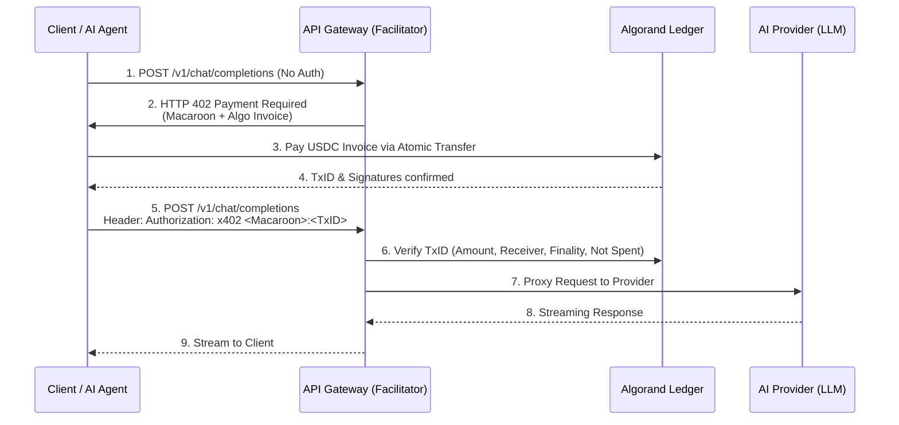

This is the Comprehensive Technical Due Diligence and System Architecture Report for the **Pay-per-use AI Marketplace (x402 + Algorand)**, prepared by our interdisciplinary engineering council.

---

## PART 1 — Problem Analysis

**The Core Problem:**
Currently, the AI API economy is shackled to a Web2 SaaS paradigm—subscriptions, pre-funded credits, and static API keys.

* **API Key Vulnerabilities:** API keys are bearer tokens. If leaked, they grant infinite access until revoked. They enforce identity, not value transfer.
* **Friction in M2M Commerce:** Autonomous AI agents cannot easily open bank accounts, sign up for Stripe, or manage monthly credit card billing. If Agent A needs to hire Agent B for a specialized OCR task, a Web2 paywall blocks this interaction.
* **Capital Inefficiency:** Pre-funding accounts (e.g., OpenAI credits) locks up developer capital.
* **The M2M Future:** As AI agents become autonomous, they will need a programmatic, natively digital way to negotiate, pay, and settle micro-services in real-time.

**Is it worth solving?**
Yes. The rise of Agentic workflows necessitates an economic layer for the internet of agents. Solving this unlocks a completely frictionless, composable ecosystem where models can interact and pay each other without human intervention.

## PART 2 — Market Research & Gap Analysis

We evaluated existing paradigms against the proposed x402/Algorand model:

| Platform | Architecture/Model | Pricing & Auth | Weaknesses vs. Proposed Idea |
| --- | --- | --- | --- |
| **OpenAI / Anthropic** | Centralized walled garden | Post-paid/Pre-paid via Fiat, API Key Auth | High barrier for M2M. Requires human KYC/Credit Card. Capital lockup. |
| **Hugging Face / Replicate** | Centralized marketplace | Usage-based Fiat, API Key Auth | Same Web2 fiat limitations. No native agent-to-agent payment layer. |
| **OpenRouter** | API aggregator (Standardized) | Pre-paid crypto/fiat credits | Still relies on centralized balances. Not true pay-per-use on-chain settlement. |
| **RapidAPI** | Universal API Hub | Monthly sub + overage | Massive friction. Cannot be dynamically triggered by an autonomous agent. |
| **Model Context Protocol (MCP)** | Open standard for context | No native payment layer | Excellent for data sharing, completely lacks an economic settlement layer. |

**Market Gap Identified:**
There is no production-grade, decentralized API gateway that combines **standardized AI proxying** with **instant, per-request cryptographic micro-settlements** without requiring centralized custody of funds.

## PART 3 — x402 Research

**What is x402?**
The HTTP 402 "Payment Required" status code was introduced in RFC 7231 (1999) but left reserved. The Lightning Network popularized L402 (formerly LSAT), marrying HTTP 402 with Macaroons (cryptographic bearer credentials) and Lightning Invoices. "x402" in this context generalizes L402 to work over any fast ledger (Algorand).

**How it Works (The Handshake):**

1. **Request:** Client sends `GET /api/v1/chat`.
2. **Challenge (402):** Server returns HTTP 402 with a `WWW-Authenticate: x402` header containing a Macaroon (auth token with caveats) and an Algorand Payment Invoice.
3. **Settle:** Client pays the Algorand invoice.
4. **Fulfill:** Client resends `GET /api/v1/chat` including the Macaroon and cryptographic proof of payment (TxID/Signature). Server validates and serves the AI response.

**Why designed this way?**
It decouples authentication from payment execution, making the API entirely stateless. The Macaroon carries the proof of authorization, while the blockchain handles double-spend prevention.

**Limitations & Integration:**

* **Latency:** The biggest risk. Waiting for L1 settlement before serving an AI request adds unbearable latency for UI-based chat apps.
* **Recommendation:** x402 must support **Payment Channels (State Channels)** or **Pre-authorized Escrow** on Algorand for streaming LLM tokens, falling back to L1 only for large, batch M2M tasks.

## PART 4 — Algorand Research

**Why Algorand?**

* **Consensus:** Pure Proof of Stake (PPoS). Unforkable.
* **Finality:** ~2.8 seconds. This is critical. Ethereum finality is ~12-15 mins. Solana finality is fast but has experienced chain halts and dropped transactions under load.
* **Fees:** 0.001 ALGO (fractions of a cent), making micro-transactions viable.
* **USDC ASA:** Algorand supports native USDC as an Algorand Standard Asset (ASA), avoiding volatile crypto payments for API usage.
* **Atomic Transfers:** Allows simultaneous execution of multiple transactions (e.g., paying the Provider, paying the Marketplace fee) in a single grouped transaction that succeeds or fails together.

**Tradeoffs:**
EVM (Base, Arbitrum) has a larger developer ecosystem and more wallet adoption. By choosing Algorand, we sacrifice immediate Web3 user base for sheer technical superiority in micro-payments.

## PART 5 — System Architecture

**Architecture Components:**

1. **Marketplace Gateway (Rust/Go):** The high-performance reverse proxy that intercepts requests, mints Macaroons, and verifies Algorand transactions.
2. **Provider Registry (Smart Contract):** On-chain or off-chain registry where providers list models and prices.
3. **Algorand Indexer/Node:** To instantly verify incoming transaction IDs from clients.
4. **Macaroon Minting Service:** Generates cryptographically secure, caveat-bound tokens.

## PART 6 — Technology Stack

* **API Gateway / Facilitator:** **Go (Golang)** or **Rust**. *Why:* Requires extreme concurrency, low GC latency, and native support for reverse-proxying streaming connections (SSE).
* **Frontend:** **Next.js** (React) + TailwindCSS. *Why:* SEO-friendly marketplace discovery, rapid prototyping.
* **Blockchain Integration:** **AlgoKit**. *Why:* Official Algorand toolset, simplifies smart contracts and indexer queries.
* **Database:** **PostgreSQL**. *Why:* Relational data for providers, models, analytics, and request logging.
* **Caching/Rate Limiting:** **Redis**. *Why:* Required for preventing double-spend of TxIDs and enforcing nonce uniqueness at low latency.
* **AI Proxying:** **LiteLLM** (Optional). *Why:* Excellent open-source tool to standardize all LLM APIs (Anthropic, OpenAI) into an OpenAI-compatible format.

## PART 7 — Database Design

*Note: The primary goal is statelessness (via Macaroons), but a DB is needed for marketplace features.*

**Core Entities:**

* `Provider`: ID, Wallet_Address, API_Endpoint, Status.
* `Model`: ID, Provider_ID, Model_Name, Price_Per_1k_Tokens (in USDC), Capabilities.
* `Transaction_Log`: ID, TxID (Indexed, Unique), Macaroon_Hash, Timestamp, Token_Count, Provider_ID.

**Scalability:**
Because Auth is handled via cryptography (Macaroons) and payments via Algorand, the DB is *not* in the critical path for the 402 handshake. It is asynchronously updated for analytics and marketplace discovery.

## PART 8 — API Architecture

* **External API:** **REST/HTTP with Server-Sent Events (SSE)** for streaming. *Why:* AI models (LLMs) fundamentally require streaming to reduce perceived latency.
* **Internal API:** **gRPC**. *Why:* High throughput communication between the Gateway and the Macaroon/Validation services.
* **Payment Challenge (402):** Adhere strictly to the `WWW-Authenticate` header standard.
* **The Streaming Problem:** How do you charge for tokens *before* you know how many the LLM will generate?
* *Solution:* The 402 invoice charges a "maximum limit" (e.g., 4096 tokens). The remaining balance is either refunded via atomic transfer, or, better, the client opens a unidirectional payment channel on Algorand and signs micro-transactions *as* tokens stream in.

## PART 9 — AI Service Layer

To succeed, this marketplace must look identical to the OpenAI API.

* Providers host their own infrastructure (vLLM, Ollama, HuggingFace TGI).
* They register a webhook with our Gateway.
* Our Gateway acts as the OpenAI-compatible proxy.
* Clients use the standard OpenAI Python SDK, but use a custom `base_url` and a wrapper script to handle the 402 handshake.

## PART 10 — Security Review

**Threat Model & Mitigations:**

1. **Double Spending of TxIDs:** A client reuses a valid TxID to get free API calls.
* *Mitigation:* Gateway caches used TxIDs in Redis with a TTL matching the Macaroon expiration.

2. **Replay Attacks:** Intercepting a valid request + Macaroon.
* *Mitigation:* Macaroons must include a strict timestamp caveat (valid for 60 seconds) and tie to the specific request payload hash.

3. **Front-running / Sybil:** Spreading micro-requests to exhaust Provider compute.
* *Mitigation:* Gateway level rate-limiting by IP or Wallet Address, independent of payments.

## PART 11 — Scalability Review

* **10-1,000 users:** Single Go Gateway, standard Postgres, remote Algorand Node (e.g., PureStake/Tatum).
* **10,000 users:** Distributed Gateway cluster. Self-hosted Algorand Archival and Indexer nodes to prevent rate-limiting by RPC providers. Redis cluster for global TxID deduplication.
* **1M+ users:** Move from L1 micro-transactions to Algorand State Channels. L1 cannot handle 10,000 TPS if every API call is a separate L1 transaction. State channels allow unlimited off-chain transactions, settling on-chain only periodically.

## PART 12 — Reliability

* **Idempotency:** The `TxID` is the ultimate idempotency key.
* **Timeouts:** AI inference is slow. The Gateway must support long-lived HTTP connections (up to 5 mins for complex workflows) while keeping the client connection alive.
* **Fallbacks:** If a specific Provider's LLM is down, the Gateway should refund the transaction (or fail the atomic transfer entirely) and route the client to an equivalent model.

## PART 13 — Existing Open Source Projects

* **Lightning Labs' Aperture:** A L402 reverse proxy. *Reuse strategy:* Study the Macaroon caveat logic, but rewrite for Algorand/HTTP instead of Lightning/gRPC.
* **LiteLLM:** Universal API proxy. *Reuse strategy:* Highly recommended for the AI routing layer.
* **Kong / Tyk:** Open-source API Gateways. *Reuse strategy:* Feasible to write custom plugins for these rather than building the Gateway from scratch.

## PART 14 — Implementation Roadmap

* **Phase 1: Research (2 weeks):** Verify Algorand Atomic Transfer latency for 402 flows.
* **Phase 2: Architecture (2 weeks):** Design Macaroon schema. Pick Go vs Rust.
* **Phase 3: Prototype (1 month):** Single endpoint returning standard text, requiring an ALGO testnet payment.
* **Phase 4: MVP (2 months):** Integration with LiteLLM. Support streaming. USDC on testnet.
* **Phase 5: Production (3+ months):** Mainnet launch, State Channels for high-frequency agents, Provider registry.

## PART 15 — Hackathon Strategy

**To win a Blockchain Hackathon:**

1. **Focus on the Demo Flow:** The "wow" moment is a split screen. Left side: An autonomous agent (Python script) looping tasks. Right side: Algorand block explorer. Show the agent hitting a 402, automatically creating a signed transaction, and the inference streaming back instantly.
2. **Acceptable Shortcuts:** Do NOT build the state channels or provider registry. Hardcode 2-3 AI models behind a Go proxy. Use ALGO (Testnet) instead of USDC to avoid ASA opt-in friction during the demo.
3. **Judges Care About:** Real-world applicability, speed, and UX. Emphasize that *this makes the Agent Economy possible today*.

## PART 16 — Improvements & Critique

**The Flaw in the Original Idea:**
Paying per *request* on L1 for LLMs is fundamentally flawed due to streaming token generation. You cannot accurately price a request before it's generated, and forcing users to over-pay and await refunds is bad UX and wastes network fees.

**The Solution:**
**Escrow + Stream-Pay.**

1. Client deposits 10 USDC into an Algorand smart contract (Escrow).
2. Gateway issues a Macaroon backed by this escrow.
3. Client streams API calls. Gateway tallies usage off-chain.
4. Gateway periodically submits cryptographic proofs of usage to the smart contract to settle balances.

## PART 17 — Final Engineering Review

**If Stripe, OpenAI, and Algorand built this:**
They would not route every API call to L1 consensus. They would build an **Off-chain State Channel Network** secured by Algorand smart contracts.

* **Technical Risks:** Macaroon caveat evaluation latency; Algorand RPC node bottlenecks.
* **Business Risks:** AI providers might refuse to host models outside of Web2 fiat ecosystems due to GPU cloud costs being billed in fiat.
* **Missing Components:** Fiat-to-USDC on-ramps. If a developer needs to buy crypto just to use an API, the friction is too high. Abstract this with a service like Stripe Crypto Onramp.

**Conclusion:** The architecture is theoretically sound and highly visionary for the Agentic AI era. However, shifting from L1-per-request to an Escrow/State Channel model is mandatory for production scale and streaming AI models.