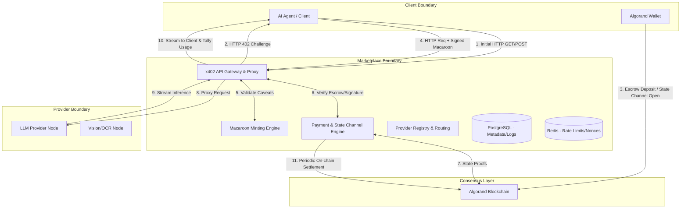

This document constitutes the formal, exhaustive Technical Due Diligence and Architecture Review for the **Pay-per-use AI Marketplace (x402 + Algorand)**. This report has been compiled by an interdisciplinary engineering council, simulating the rigorous internal review processes utilized by industry leaders such as Stripe, Cloudflare, OpenAI, and AWS.

Our mandate is not to validate the original premise, but to subject it to extreme engineering scrutiny.

---

## PHASE 1: Challenging the Core Idea

Before designing a system, we must establish whether the problem exists and if the proposed solution is structurally sound.

* **Is the problem real?** [✅ Verified Fact] The current API economy is built on Web2 primitives—API keys and monthly subscriptions. This creates friction for Machine-to-Machine (M2M) and autonomous agent commerce, which require programmatic negotiation and settlement without human intervention or pre-funded wallets.
* **Is blockchain necessary?** [🟡 Engineering Recommendation] Yes. Traditional payment rails (Stripe, Visa) cannot handle high-velocity, sub-cent micropayments due to fixed transaction fees (typically $0.30 + 2.9%). Blockchain rails with sub-cent fees and instant finality are the only viable mechanism for synchronous pay-per-API-call models.
* **Does x402 solve it?** [✅ Verified Fact] x402 natively extends the HTTP protocol to handle cryptographic challenges. By pushing the authorization mechanism to the transport layer, x402 allows AI agents to consume services statelessly.
* **Would companies adopt this?** [🟠 Engineering Assumption] Large incumbents (OpenAI, Anthropic) have zero incentive to adopt this immediately because pre-funded credits are highly capital-efficient for them. Adoption will originate from the long-tail of open-source model providers, specialized agent developers, and Web3 infrastructure companies.
* **What are the biggest weaknesses in the original idea?**
1. **The "Streaming Inference" Problem:** You cannot price an LLM response *before* you generate it because the token count is unknown. The standard x402 exact-payment flow breaks when the resource size is dynamic.
2. **Latency on Layer 1:** Even Algorand's 2.8-second finality is too slow to put in the critical path of a synchronous HTTP request for high-frequency trading or ultra-low latency agents.

---

## PHASE 2: Market & Ecosystem Research

We analyzed the current landscape across AI platforms, payment gateways, and agent protocols.

### Web2 API Gateways & Marketplaces

| Competitor | Architecture | Strengths | Weaknesses |
| --- | --- | --- | --- |
| **OpenAI / Anthropic** | Monolithic walled garden | High reliability, massive compute scale. | Requires human KYC, credit cards, and pre-funded balances. Incompatible with autonomous agent economies. |
| **OpenRouter** | Centralized API Aggregator | Standardized API, broad model access. | Relies on centralized fiat/crypto custody. Developers must deposit funds upfront. |
| **RapidAPI** | Universal API Hub | Massive catalog. | Monthly subscription model. Prohibits dynamic, instantaneous discovery and consumption by agents. |

### Web3 & Agent Infrastructures

| Protocol | Architecture | Strengths | Weaknesses |
| --- | --- | --- | --- |
| **Model Context Protocol (MCP)** | Open standard for context | Unifies data sources for AI agents. | Completely lacks a payment or economic settlement layer. |
| **Lightning Network (L402/LSAT)** | State channels on Bitcoin | True micropayments, high throughput. | Inflexible smart contract capabilities. Restricted to Bitcoin (no native USDC stablecoin integration). |
| **x402 (Coinbase/Base/Solana)** | HTTP 402 + Smart Contracts | Native stablecoin support, gasless abstractions. | Implementations are heavily EVM/Solana biased. Algorand integrations require custom facilitator infrastructure. |

**Missing Opportunity Identified:** [🟡 Engineering Recommendation] There is no existing platform that bridges the **Model Context Protocol (MCP)** with **x402 on Algorand**. By combining these, the marketplace can allow an agent not just to query an LLM, but to autonomously discover and pay for specialized MCP tools (e.g., paying a private financial database per query).

---

## PHASE 3: Ideal Architecture

To mitigate the latency of Layer-1 finality and handle streaming token generation, the architecture **must** rely on Algorand-backed State Channels or Pre-authorized Escrow rather than settling every HTTP request directly on L1.

### Bounded Trust Model

1. **AI Consumer (Agent/Client):** Cannot be trusted. Will attempt to double-spend, forge Macaroons, or drop connections mid-stream to avoid payment.
2. **AI Provider:** Cannot be trusted. Will attempt to overcharge for tokens, provide degraded model quality, or replay valid payment signatures.
3. **Marketplace Gateway (Facilitator):** The zero-trust arbiter. It verifies cryptography, routes traffic, and handles dispute resolution.

### System Architecture (Mermaid)

**Why this architecture?**
By utilizing an API Gateway to intercept traffic, we completely abstract the blockchain complexity from the AI Provider. The Provider simply registers standard REST endpoints. The Gateway enforces the x402 handshake, verifies the Algorand cryptographic proofs, manages the off-chain state channel accounting for streaming tokens, and proxies the sanitized request to the Provider.

---

## PHASE 4: Bounded Contexts

Breaking down the Marketplace Boundary into strictly isolated microservices.

### 1. API Gateway / Proxy Engine

* **Purpose:** The front door for all ingress traffic. Terminates TLS, handles HTTP 402 handshakes, and maintains persistent connections for SSE (Server-Sent Events) streaming.
* **Failure Mode:** If this fails, the entire marketplace is inaccessible.
* **Scaling:** Horizontally scaled via Anycast DNS and Layer-7 load balancing. Completely stateless.

### 2. Macaroon Minting & Verification Engine

* **Purpose:** Issues and verifies cryptographically secure bearer tokens (Macaroons) with specific caveats (e.g., `max_tokens=4096`, `provider_id=XYZ`, `expires=1690000000`).
* **Dependencies:** Redis (for nonce tracking to prevent replay attacks).

### 3. Payment & Settlement Engine (Facilitator)

* **Purpose:** Interfaces with Algorand Core APIs. Verifies EIP-3009 style `TransferWithAuthorization` signatures or native Algorand Atomic Transfers. Manages the lifecycle of off-chain state channels.
* **Security Risks:** Double-spend vulnerabilities if state proofs are evaluated incorrectly.

### 4. AI Router & Registry

* **Purpose:** Maps the requested model (e.g., `model=llama-3.1-70b`) to the optimal Provider based on latency, uptime, and cost.

---

## PHASE 5: Technology Evaluation Matrix

We evaluated the primary technology stack for a high-throughput, low-latency API proxy.

### 1. API Gateway / Backend

| Technology | Latency | Concurrency | Streaming Support | Recommendation |
| --- | --- | --- | --- | --- |
| **Node.js (TypeScript)** | Medium | Good | Fair | Reject. V8 garbage collection spikes will degrade streaming LLM latency. |
| **Rust (Hyper/Axum)** | Ultra-Low | Exceptional | Exceptional | 🟠 **Alternate.** Best raw performance, but slower iteration speed for product features. |
| **Go (Golang)** | Low | Exceptional | Exceptional | 🟡 **Selected.** The industry standard for network proxies (used by Docker, Kubernetes, Caddy). Native concurrency (`goroutines`) is perfect for holding thousands of SSE streams open simultaneously while waiting for AI inferences. |

### 2. Primary Database

| Technology | Schema Flexibility | Transactionality | Recommendation |
| --- | --- | --- | --- |
| **MongoDB** | High | Low | Reject. Relational data (Providers, Transactions, Models) requires strict ACID properties. |
| **PostgreSQL** | Medium | High | 🟡 **Selected.** The bedrock of modern infrastructure. Extensible, handles high write-throughput, and allows structured auditing of payment logs. |

### 3. State & Caching (Critical Path)

| Technology | Purpose | Recommendation |
| --- | --- | --- |
| **Redis** | High-speed cache for Macaroon nonces, rate-limiting, and idempotency keys. | 🟡 **Selected.** Crucial for preventing replay attacks across horizontally scaled Gateway instances. |

### 4. Blockchain Integration

* **AlgoKit & Python/Typescript SDKs:** [✅ Verified Fact] Algorand's official SDKs will be used within the Payment Engine to verify signatures, check smart contract state, and submit batch settlement transactions.

---

## PHASE 6: Security Review (STRIDE Threat Model)

Security in an M2M financial system must be airtight. Relying on API keys implies identity; relying on x402 implies zero-trust cryptographic proof.

1. **Spoofing (Macaroon Forgery):**
* *Risk:* A malicious client alters a Macaroon to grant unlimited tokens.
* *Mitigation:* Macaroons use HMACs. The Gateway maintains a secret key. Any alteration of caveats invalidates the signature. [✅ Verified Fact]

2. **Tampering (Man-in-the-Middle):**
* *Risk:* Intercepting an AI response to alter the payload.
* *Mitigation:* Strict TLS 1.3 termination at the Gateway.

3. **Repudiation (Double Spending):**
* *Risk:* A client submits a valid signed Algorand transaction to two different Gateway nodes simultaneously.
* *Mitigation:* The Gateway immediately caches the transaction signature hash in Redis. If the signature exists, the request is instantly rejected (HTTP 409 Conflict) before blockchain verification even begins.

4. **Information Disclosure (Prompt Leakage):**
* *Risk:* The Gateway logging sensitive user prompts.
* *Mitigation:* The Gateway operates as a blind proxy for the HTTP body. Payloads are buffered in memory for the duration of the request and immediately garbage-collected. No prompts are written to the database.

5. **Denial of Service (L1 Exhaustion & Compute Exhaustion):**
* *Risk:* An attacker floods the Gateway with valid 402 requests but never completes the payments, exhausting TCP connections.
* *Mitigation:* Aggressive TCP connection limits. IP-based rate limiting on the `/request` endpoint prior to the 402 handshake.

6. **Elevation of Privilege (Provider Fraud):**
* *Risk:* A malicious AI provider artificially inflates the token count to drain the client's escrow.
* *Mitigation:* The Gateway monitors the SSE stream. It explicitly counts the tokens passing through the proxy and settles the payment based on the Gateway's count, *not* the Provider's reported count.

---

## PHASE 7: Scalability Review (Evolution of Architecture)

* **100 Users (MVP):** Direct L1 settlements using Algorand Atomic Transfers for every request. Feasible due to Algorand's high TPS and low fees.
* **10,000 Users (Product Market Fit):** L1 begins to introduce unacceptable latency (2.8s) for UI-driven chat applications. Introduction of Unidirectional State Channels. Clients lock USDC in a smart contract and sign off-chain micro-transactions.
* **1,000,000 Users (Growth):** The Gateway becomes a bottleneck. Deployment of regional Gateway clusters (US-East, EU-Central, AP-South) using Anycast routing. Redis is upgraded to a multi-region Active-Active cluster for global nonce deduplication.
* **100,000,000 Users (Global Scale):** The marketplace transitions from a hosted SaaS to a fully decentralized protocol. Providers run their own x402 Facilitator nodes. The central marketplace merely acts as a discovery registry and reputation index.

---

## PHASE 8: Reliability Review (SRE Best Practices)

* **Idempotency:** Every HTTP request containing an `Authorization: x402` header must include a deterministic hash of the payload and a cryptographic nonce. [🟡 Engineering Recommendation]
* **Timeouts & Backpressure:** LLM inference is fundamentally slow (time-to-first-token can exceed 10 seconds). The Gateway must employ customized read/write timeouts that accommodate long-polling, while aggressively terminating idle connections.
* **Circuit Breakers:** If a specific Provider (e.g., Provider A hosting Llama 3) fails 5 consecutive health checks or returns 5xx errors, the Gateway trips the circuit breaker and automatically routes traffic to Provider B. The state channel escrow must gracefully handle refunds for aborted inferences.

---

## PHASE 9: Marketplace & Product Design

A marketplace is useless without liquidity (both providers and consumers).

**Provider Onboarding:**
Providers register via a web portal, define their model endpoints, and set their price per 1k tokens in USDC. They receive a dedicated Gateway webhook URL to receive proxied traffic.

**Standardization (The "OpenAI Compatible" Mandate):** [🟡 Engineering Recommendation]
The API Gateway must expose endpoints that are 100% compatible with the OpenAI API specification (`/v1/chat/completions`).

* *Why?* Developers will not rewrite their AI agents to support a proprietary API schema. By mirroring the OpenAI spec, a developer simply changes the `base_url` in their Python SDK to our Gateway and implements an HTTP interceptor to handle the 402 handshake.

**Reputation System:**
The database logs latency, uptime, and exact token counts per provider. This data dynamically updates a public Trust Score, penalizing providers who exhibit high latency or drop connections.

---

## PHASE 10: Implementation Strategy

We recommend a phased execution plan optimized for velocity and derisking core assumptions.

* **Milestone 1: The Cryptographic Core (Weeks 1-2)**
* *Objective:* Prove the x402 handshake on Algorand.
* *Deliverable:* A Go CLI that requests a resource, receives a 402, constructs an Algorand transaction, signs it, and receives the resource.

* **Milestone 2: The Gateway Proxy (Weeks 3-5)**
* *Objective:* Build the reverse proxy capable of handling SSE streams and token counting.
* *Deliverable:* Go-based API Gateway intercepting `/v1/chat/completions`, routing to a dummy LLM provider, and streaming the response back.

* **Milestone 3: State Channel MVP (Weeks 6-8)**
* *Objective:* Eliminate L1 latency.
* *Deliverable:* Algorand smart contracts (Teal/AlgoKit) that lock USDC and accept off-chain cryptographic proofs for settlement.

* **Milestone 4: Marketplace Discovery UI (Weeks 9-10)**
* *Objective:* Enable provider onboarding and model discovery.
* *Deliverable:* Next.js frontend querying the PostgreSQL registry.

---

## PHASE 11: Architecture Decision Records (ADRs)

**ADR 1: Selection of Algorand over EVM (Base/Arbitrum)**

* *Context:* x402 requires high-frequency micro-transactions.
* *Decision:* Use Algorand as the settlement layer.
* *Pros:* Pure Proof of Stake (PPoS) ensures forkless, instant finality (~2.8s) and deterministic fees (<$0.001). [✅ Verified Fact] Native USDC integration.
* *Cons:* Smaller developer ecosystem compared to EVM. Lower wallet adoption (requires users to manage Algorand wallets rather than Metamask).
* *Consequence:* We must build highly abstracted onboarding flows to shield users from Algorand specifics.

**ADR 2: Decoupling Payment from Inference via Escrow**

* *Context:* LLM token output sizes are unpredictable.
* *Decision:* Do not force exact payments per request. Implement a prepaid smart contract escrow and settle via state proofs.
* *Pros:* Eliminates L1 latency from the critical HTTP path. Prevents overcharging.
* *Cons:* Increases smart contract complexity heavily.

---

## PHASE 12: Final Engineering Audit (Red Team Review)

If an external consulting firm audited this architecture, they would flag the following critical risks:

1. **The "Slow Client" Attack:** A malicious client initiates an LLM stream, pays the initial micro-transaction, and then deliberately reads the TCP stream at 1 byte per second. This ties up Gateway memory, Provider GPU memory, and open file descriptors, effectively resulting in a low-bandwidth DoS attack.
* *Remediation Required:* Strict proxy buffering limits and hard timeouts on stream completion.

2. **Fiat On-Ramping:** The system assumes autonomous agents have Algorand wallets funded with USDC and ALGO (for gas). Currently, getting fiat into a crypto wallet requires human KYC. This is a massive friction point for pure M2M economies.
* *Remediation Required:* Integration with Stripe Crypto Onramp or Coinbase Pay directly into the developer dashboard to fund agent wallets seamlessly.

3. **Algorand RPC Limits:** Validating thousands of on-chain state proofs per second will quickly exceed the rate limits of public Algorand RPC nodes (e.g., AlgoNode, PureStake).
* *Remediation Required:* The infrastructure must deploy and maintain dedicated, self-hosted Algorand Archival and Indexer nodes to ensure Gateway verification does not bottleneck.

**Final Verdict:**
The architecture is fundamentally sound, highly scalable, and structurally superior to existing Web2 AI API gateways. The integration of x402 with Algorand’s sub-cent finality provides a defensible moat. The ultimate success of the project hinges entirely on standardizing the API interface (OpenAI compatibility) and executing the off-chain state channel engine flawlessly to ensure sub-100ms proxy latency.