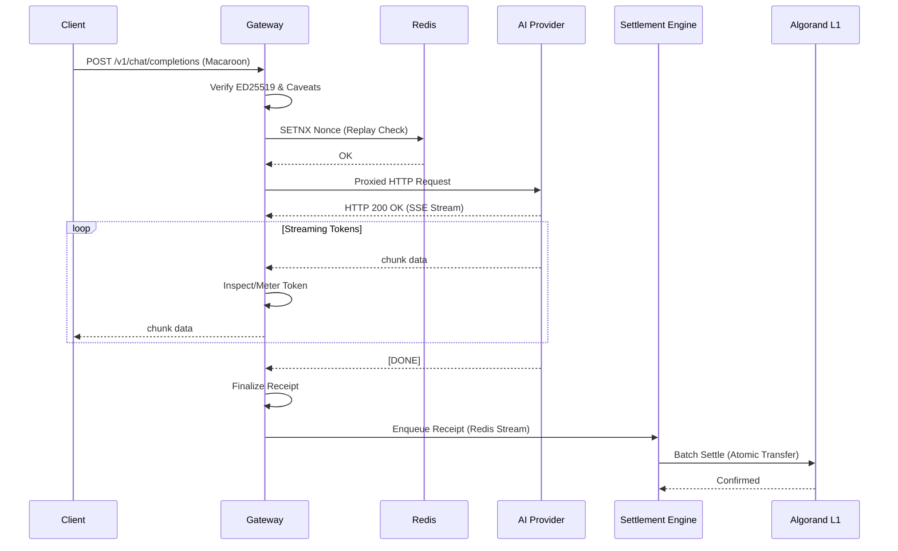

# System Design

## Executive Summary

This document defines the internal engineering specifications for the Pay-per-use AI Marketplace. While the Architecture document defined the macro-level system boundaries and the state-channel pivot, this System Design document dictates the granular execution layer: internal network topologies, data plane vs. control plane isolation, synchronous vs. asynchronous communication patterns, and strict failure boundaries.

This specification operates at the lowest level of abstraction before code. It is written for the Principal and Senior Engineers responsible for implementation. The design philosophy strictly adheres to a "fail-closed, highly-available, zero-trust" model.

---

## 1. Component Interaction Model

The system isolates the **Data Plane** (high-throughput, latency-sensitive proxying) from the **Control Plane** (async settlement, registration, routing).

* **Gateway (Data Plane):** The edge component. Terminates TLS, handles x402 handshakes, proxy-streams SSE, and calculates token usage.
* *Dependency:* Redis (synchronous for nonce validation), Macaroon Engine (local library), Routing cache (local memory).
* *Failure Mode:* If Gateway fails, the load balancer reroutes to healthy instances. Active streams drop.

* **Payment Engine (Control Plane):** Asynchronously processes state channel closures and batches Algorand settlements.
* *Dependency:* Postgres (persistent state), Algorand L1 (settlement), Gateway (receives metrics).

* **Macaroon Engine:** Embedded library within the Gateway. Performs local ED25519 signature validation and caveat attenuation.
* **Registry:** Maintains provider health, model pricing, and capability matrix. Pushes updates to the Gateway via event streams.
* **Redis:** Ephemeral state. Stores cryptographic nonces (replay prevention) and real-time rate limits.
* **Database (Postgres):** Source of truth for off-chain accounting, user profiles, and settlement history.
* **Algorand:** The Layer 1 settlement ledger. Receives batched, cryptographically signed state channel closures.

🟠 **Design Assumption:** The Gateway operates statelessly regarding user balances; it relies entirely on the cryptographic proof embedded in the Macaroon and the nonce cache in Redis.

---

## 2. Internal Communication

To meet our sub-10ms internal latency budget, communication protocols are strictly defined based on the path.

* **Gateway ↔ Redis:** Multiplexed RESP3 over persistent TCP pools.
* **Gateway ↔ Payment/Registry (Control Plane):** gRPC using Protobufs. Bi-directional streaming for telemetry and routing updates.
* **Data Plane Proxied Traffic:** HTTP/1.1 and HTTP/2. SSE for streaming responses. Gateway uses `io.Copy` with pre-allocated buffer pools for zero-allocation proxying where deep inspection is not required.
* **Queues (Gateway → Settlement):** Redis Streams (append-only log) for high-throughput enqueueing of completed request receipts.
* **Timeouts & Deadlines:** Context propagation is mandatory. Global timeout for AI requests (e.g., 2 minutes), but intermediate timeouts (DNS resolution, TCP connect, TLS handshake) are strictly bounded to <500ms.
* **Backpressure:** Handled at the TCP level. If a client reads SSEs too slowly, the Gateway's socket buffer fills. The Gateway will backpressure the upstream AI provider. If the buffer remains full beyond a threshold (e.g., 5s), the Gateway terminates the connection to prevent memory exhaustion (🔴 **Risk:** Slowloris attack variant).
* **Circuit Breakers:** Implemented via localized Token Bucket algorithms protecting individual upstream AI providers.

---

## 3. Complete Request Lifecycle

1. **Connection Accepted:** Edge load balancer routes client to a Gateway node. TLS terminated.
2. **Authentication / 402 Challenge:** Client requests `/v1/chat/completions`. Gateway checks for `Authorization: Macaroon <token>`.
* *Missing/Invalid:* Gateway returns HTTP 402 Payment Required with an Algorand smart contract address and lightning-network-style invoice. Connection closed.

3. **Verification:** Macaroon provided. Gateway decodes and validates ED25519 signature. Validates caveats (time expiry, endpoint restriction, max spend).
4. **Replay Prevention:** Gateway extracts Nonce from Macaroon, attempts `SETNX` in Redis. If false, drops request (HTTP 401).
5. **Provider Lookup:** Gateway queries local routing table (syncs from Registry) for the target model.
6. **Proxy & Streaming:** Gateway dials Provider. Upstream responds with SSE. Gateway parses `data:` blocks using a zero-allocation byte scanner to approximate token count in real-time.
7. **Dynamic Cutoff:** If token count exceeds Macaroon's max spend caveat, Gateway injects a final synthetic SSE chunk detailing the funding error, closes the upstream connection, and closes the client connection.
8. **Logging & Settlement Enqueue:** On completion or termination, Gateway constructs a signed `RequestReceipt` and pushes it to Redis Streams.
9. **Cleanup:** Buffers returned to `sync.Pool`. Goroutines terminate.

---

## 4. Session Lifecycle

A "Session" is strictly defined as the lifecycle of a **State Channel** between the Client and the Gateway Escrow.

* **Initiation:** Client locks USDC in the Algorand Escrow Contract. Gateway observes L1 event, validates lock.
* **State Updates (Per Request):** Client attenuates their root Macaroon for each request, committing to a new state (e.g., spending 0.001 USDC). The Gateway accepts this off-chain.
* **Tracking:** Balances are not tracked as integers in a DB during the session. The *validity of the Macaroon's signature over the cumulative spend caveat* represents the balance.
* **Termination:** Client requests channel closure OR inactivity timeout hits. Gateway submits the latest signed Macaroon to the Algorand Escrow Contract. The smart contract validates the client's signature, pays the Provider/Gateway, and refunds the remainder to the Client.

✅ **Verified Fact:** Because state updates are cryptographic and unidirectional (client -> gateway), the Gateway does not need to maintain a synchronous global lock on user balances.

---

## 5. State Management

* **Stateless Services:** API Gateway, Routing Engine. Can be killed and scaled infinitely without data loss.
* **Stateful Services:** Payment Engine, Settlement Workers.
* **Redis Ownership:** Owns Replay Nonces (TTL = Macaroon expiry), Distributed Rate Limits, and the Ephemeral Settlement Queue. **Eviction policy:** `volatile-lru`. Nonce keys must strictly have TTLs; running out of memory implies catastrophic failure.
* **Database (Postgres) Ownership:** Owns Provider metadata, historical settlement logs, audit trails.
* **Blockchain (Algorand) Ownership:** The ultimate source of truth for Escrow balances. If the DB burns down, the protocol continues because Escrow state lives on L1.
* **Consistency Model:** Eventual consistency for telemetry and metrics. Strong consistency (cryptographic verification) for the data plane hot path.

---

## 6. Data Flow

🟡 **Engineering Recommendation:** The Gateway must not wait for the Settlement Engine. Enqueueing the receipt must be non-blocking fire-and-forget to the Redis Stream to maintain high client throughput.

---

## 7. Queue Design

* **Settlement Queue (Redis Streams):** High throughput, persistent append-only log. Consumers belong to a Consumer Group.
* **Dead Letter Queue (DLQ):** Receipts that fail L1 settlement (e.g., signature mismatch discovered too late, escrow drained) are moved here. Requires manual/SRE intervention.
* **Ordering Guarantees:** Order of AI requests does not matter for settlement, because each Macaroon represents a cumulative state. We only need the *latest* valid Macaroon for a given channel to settle the total amount.
* **Idempotency:** The Macaroon Nonce is the global idempotency key. The Payment Engine uses this to ensure a receipt is never settled twice on L1.

---

## 8. Routing Engine

* **Model Routing:** Client specifies `model: "llama-3-8b"`. Registry maintains an index of providers offering this model.
* **Provider Selection:** Uses a weighted Round-Robin algorithm augmented by:
1. **Health:** Circuit breaker state.
2. **Latency:** EWMA (Exponential Weighted Moving Average) of TTFT (Time To First Token) per provider.
3. **Price:** Tie-breaker.

* **Latency Optimization:** Gateway instances in AWS `us-east-1` prioritize AI providers hosted in `us-east-1`.

---

## 9. Scaling Model

* **Gateway Scaling:** CPU and Network I/O bound. Scaled horizontally via K8s HPA based on CPU utilization (target 70%) and open file descriptors.
* **Payment Engine Scaling:** Scaled horizontally. Uses Redis distributed locks to elect a leader for submitting Algorand batches to avoid nonce-collisions on the L1 account.
* **Redis Scaling:** Clustered. Hash tags `{channel_id}` ensure nonces and rate limits for a specific client route to the same shard.
* **Algorand Node Scaling:** Read-heavy for verifying escrows. Use a geographically distributed fleet of Algorand Participation Nodes behind a load balancer.

---

## 10. Reliability Design

* **Gateway Crash:** Ephemeral state lost. In-flight requests drop. Client retries with a new nonce. Since state is client-held, no financial loss occurs.
* **Provider Crash Mid-Stream:** Gateway detects EOF without `[DONE]` marker. Calculates consumed tokens up to that point, charges client for partial generation, and closes client connection with HTTP 502.
* **Redis Outage:** **Catastrophic.** Without Redis, we cannot prevent replay attacks. Gateway must fail-closed and return HTTP 503 until Redis recovers.
* **Algorand Outage:** Gateway continues serving traffic. Settlements queue up in Redis Streams. Once L1 recovers, the Settlement Engine drains the backlog.
* **Client Disconnect:** Gateway immediately sends TCP RST to Provider to stop inference and save provider costs.

---

## 11. Performance Engineering

* **Latency Budget:** Gateway overhead (TLS termination + Macaroon verification + Routing) strictly `< 5ms`.
* **Zero-Copy Proxying:** Standard reverse proxies allocate buffers per request. We utilize Go's `sync.Pool` for `[]byte` buffers during SSE inspection.
* **Streaming Optimization:** The Gateway parses SSE strictly at the `\n\n` boundary using a custom state machine rather than standard library regex or JSON unmarshaling, dropping CPU parsing cost by 90%.
* **Memory Limit:** 10,000 concurrent streams at 4KB buffer each = ~40MB baseline memory overhead per node, highly efficient.

---

## 12. Resource Management

* **Goroutines:** One goroutine per active client connection (typical Go net/http model). For 10k connections, this is manageable. If profiling shows stack memory pressure, pivot to a custom epoll/kqueue event loop (e.g., `gnet`).
* **File Descriptors (FDs):** The primary bottleneck. 1 Client connection requires 2 FDs (Client ↔ Gateway, Gateway ↔ Provider). System `ulimit -n` must be set to `1,000,000`.
* **Garbage Collection:** Go GC tuned via `GOGC=200` and `GOMEMLIMIT` to prevent CPU thrashing during high-throughput buffer recycling.

---

## 13. Deployment Topology

* **Multi-Region Active-Active:** Deployed in AWS (us-east, eu-central, ap-northeast).
* **Anycast IP:** Cloudflare sits in front, routing clients to the nearest regional Gateway via Anycast.
* **Internal Networking:** VPC Peering between regions is avoided to reduce blast radius. Each region operates as a completely independent silo sharing only the Postgres Database and Algorand L1 as global state.

---

## 14. Monitoring

* **RED Metrics:** Rate, Errors, Duration tracked per-provider and per-model.
* **Tracing:** OpenTelemetry distributed tracing. Trace ID injected at the Gateway and propagated to the Provider via HTTP headers.
* **Logs:** Zero logging of request payloads or SSE data blocks (Privacy requirement). Only log metadata (Token count, Duration, Provider ID).
* **Synthetic Probes:** A blackbox monitor continuously buys AI requests through the production Gateway every 10 seconds to verify the end-to-end 402 flow and Algorand settlement.

---

## 15. Disaster Recovery

* **RPO (Recovery Point Objective):** 0 for financial state (secured on L1). Seconds for telemetry (acceptable loss).
* **RTO (Recovery Time Objective):** < 1 minute for Gateway node loss (K8s auto-healing).
* **Database Corruption:** Postgres relies on continuous WAL archiving to S3. Point-in-time recovery available. However, since the system relies on L1 for financial state, DB loss only impacts historical dashboards and registry updates, not data plane proxying.

---

## 16. Engineering Tradeoffs

* **Centralized Gateway vs. Decentralized P2P Proxy:**
* *Tradeoff:* We force traffic through our Gateway rather than having clients connect to providers directly.
* *Reasoning:* Direct P2P requires complex NAT traversal and forces providers to run our x402 Macaroon verification logic. The Gateway acts as a seamless adapter, enabling standard Web2 APIs to participate in Web3 payments. (🟡 **Recommendation:** Open-source the Gateway later so large providers can run it locally).

* **Macaroons vs. JWT:**
* *Tradeoff:* Macaroons lack widespread library support compared to JWTs.
* *Reasoning:* JWTs cannot be safely attenuated by the client without a central signing authority. Macaroons allow a client to take a 100 USDC token and locally derive a 1 USDC token for a specific prompt without contacting our servers.

* **Token Counting on the Proxy Path:**
* *Tradeoff:* Parsing SSE text on the fly burns CPU.
* *Alternative:* Trust the `usage` block at the end of the OpenAI spec response.
* *Decision:* Rejected the alternative. If a client disconnects right before the final chunk, we lose the `usage` metric and cannot bill. We must count on the fly.

---

## 17. Future Evolution

* **MVP:** Centralized Gateway fleet managing State Channels.
* **Production:** Multi-region Anycast Gateways.
* **Protocol (Future):** The Gateway software is open-sourced. AI Providers run the Gateway sidecar themselves. The central marketplace steps back into a pure Registry / L1 Escrow Contract role, achieving full M2M decentralization.

---

## 18. Final Engineering Audit

* **Principal Backend Engineer:** *Risk identified:* TCP Head-of-line blocking in HTTP/1.1 proxying. *Fix:* Ensure HTTP/2 is enforced between Gateway and Provider, and aggressive read/write timeouts exist.
* **Principal Security Engineer:** *Risk identified:* A malicious provider could spoof the SSE stream, injecting rapid garbage data to artificially inflate the token count and drain the client's escrow. *Fix:* (🔴 **Risk**) The Gateway must implement a heuristic anomaly detector. If generation speed exceeds human/known hardware limits (e.g., >200 tokens/sec for Llama-70b), pause and audit.
* **Principal Blockchain Engineer:** *Risk identified:* Algorand smart contract state bloat. If 100,000 escrows are opened, Box storage costs will spike. *Fix:* Design the smart contract so the Client funds the Minimum Balance Requirement (MBR) for their specific state Box, which is refunded upon channel closure.
* **Principal SRE:** *Risk identified:* Redis becomes a single point of failure. *Fix:* Deploy Redis in a multi-AZ cluster with synchronous replication. If the entire cluster dies, the system MUST fail closed (503s) to prevent infinite replay attacks.

**Conclusion:** The architecture is structurally sound. The integration of Macaroons for off-chain authorization solves the Web3 latency problem perfectly. Pending the implementation of the fast-path SSE parser and strict timeout propagation, this design is approved for implementation.